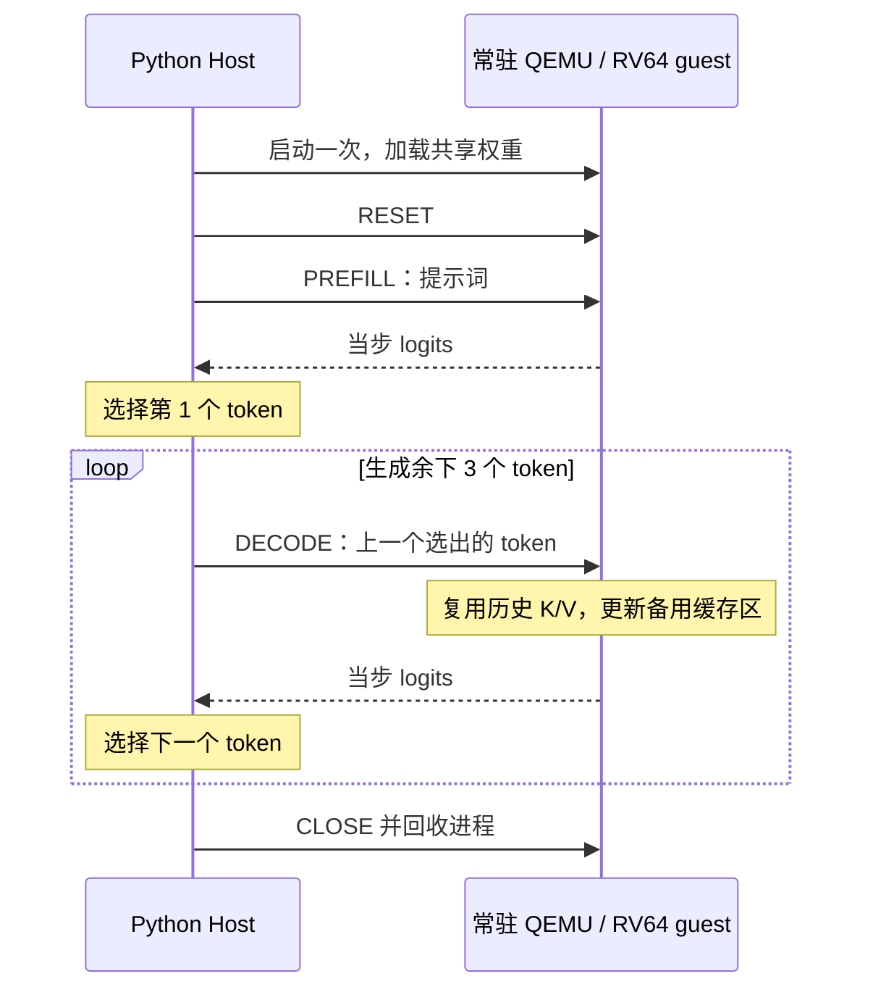

# KV cache 推理性能报告

## 1. 提高了多少速度

目前有两类可以量化的结果：

| 测量对象 | 实测结果 |  |
|---|---|---|
| 同条件小模型，单核 QEMU，生成 4 个 token | 无缓存 **1.663360 s** → KV cache **0.415921 s** |  |
| 完整 Qwen3-0.6B，四核 QEMU | Prefill **236.458 s**；后续 Decode 平均 **18.168 s/步** |  |
| 完整 Qwen3-0.6B，四核 QEMU，生成 4 个 token | 四次前向请求合计 **290.963 s**；整轮验证 **304.887 s** |  |

小模型的 4.00 倍反映本次完整 KV 推理路径的合计收益，包括历史 K/V 复用、单 token Decode、QEMU 常驻和输出缩减。当前没有逐项关闭优化的消融实验，因此不能为每项改动分别分配一个加速倍数。

本报告中的时间均为 **QEMU/TCG 在宿主机上的经过时间**

## 2. 同条件小模型对照：约 4.00 倍

### 测试条件

| 项目 | 配置 |
|---|---|
| 模型 | 两层 Qwen3 结构，固定随机权重 seed=0，不是完整预训练 0.6B |
| 结构 | hidden_size=32、4 个 Q head、2 个 KV head、head_dim=16、词表 128 |
| 输入与输出 | token ID `1..17` 作为提示词，生成 4 个 token |
| 精度与形状 | FP32、batch=1、容量 256 |
| 执行 | 单核 QEMU，`sequential / libm`；两条路径使用相同权重、算术策略和 token 预算 |
| 采样 | 单次串行对照，无预热；先无缓存，后缓存；未清空宿主页缓存 |

| 指标 | 无缓存 | KV cache |
|---|---:|---:|
| 生成总耗时 | 1.663360 s | 0.415921 s |
| 本次 4-token 调用的平均吞吐量 | 2.4048 token/s | 9.6172 token/s |
| QEMU 启动次数 | 4 | 1 |
| 模型调用 | 4 次完整历史重算 | 1 次 Prefill + 3 次 Decode |
| 生成 token ID | `[17, 17, 17, 17]` | `[17, 17, 17, 17]` |

计算方式：

```text
速度倍数 = 无缓存耗时 / 缓存耗时
         = 1.663360255 / 0.415921132
         ≈ 3.9992，即约 4.00 倍

耗时减少比例 = 1 - 缓存耗时 / 无缓存耗时
             ≈ 74.9951%，即约 75.00%
```

无缓存包含四次启动、加载、前向、输出传输与清理;缓存包含一次启动、加载、RESET、Prefill、三次 Decode、输出传输、选 token 与清理。两者都不包含模型导出和 C/ELF 编译。

是单次样本

实现入口：[同条件 benchmark](../../../probes/w6_kv_cache/run.py) 中的 `benchmark()`。保留的原始报告路径为 `output/kv-benchmark-serial-1/benchmark.json`。

## 3. 具体时间花费

### 模型与运行条件

- 模型：`Qwen/Qwen3-0.6B`，revision `c1899de289a04d12100db370d81485cdf75e47ca`，使用原始预训练权重，加载为 FP32。
- 结构：28 层、hidden_size=1024、16 个 Q head、8 个 KV head、head_dim=128、词表 151936。
- 执行：四核 RV64GC / LP64D、QEMU `virt`、bare metal，QEMU 11.1.2，Zig 0.14.1，Zig 自带 musl。
- 算术策略：MatMul `blocked_fma / 2x4 / column-panel`，Mean `two-four-lane-last-axis`，非线性 `fp32-reference`。
- 提示词：`The capital of France is`，官方分词器编码为 `[785, 6722, 315, 9625, 374]`，共 5 个 token。
- 输出：`[12095, 13, 576, 6722]`，解码为 ` Paris. The capital`。

### 逐步耗时

| 步骤 | 模型输入 | 得到的 token | 前向请求耗时 |
|---|---|---|---:|
| Prefill | 5-token 提示词，填充到静态长度 256 | `12095`，` Paris` | 236.457624 s |
| Decode 1 | token `12095` + 既有缓存 | `13`，`.` | 18.304653 s |
| Decode 2 | token `13` + 既有缓存 | `576`，` The` | 18.125059 s |
| Decode 3 | token `576` + 既有缓存 | `6722`，` capital` | 18.075660 s |
| 合计 | 1 次 Prefill + 3 次 Decode | 4 个新 token | **290.962997 s** |

这里的 `forward_s` 从 Host 发出请求计到接收完成帧，包含协议往返、guest 输入准备、模型执行及 guest 输出检查；它不是 CPU 算子内部的纯计算计时，也不包含随后通过 QMP 读取 logits 的时间。

三次 Decode 平均为 **18.168458 s/步**，阶段吞吐量约 **0.0550 token/s**。Prefill 请求耗时除以 Decode 平均耗时为 **13.0147**。这个比值展示两种工作量的差别，不能解释成“打开 KV 后整轮生成快了 13 倍”。

### 几种总耗时

| 计时项 | 实测 | 范围 |
|---|---:|---|
| QEMU 会话启动 | 11.729474 s | 包括启动阶段的制品验证、权重准备、QEMU 启动与 READY 握手 |
| 四次前向请求之和 | 290.962997 s | 上表四个请求的 `forward_s` 之和 |
| 生成循环 | 291.813700 s | 包括 RESET、请求、logits 读取、选 token；本次额外带逐步 K/V 读取、数值对照和保存 |
| 完整 QEMU 验证阶段 | **304.886606 s** | 包括阶段自检、会话启动、生成与缓存审计、再次 RESET 和清理 |
| C/ELF 编译 | 57.800899 s | 独立构建阶段，不计入上述 304.886606 s |

因此，之前提到的“4 个 token 约 5 分 5 秒”指整轮验证。`291.813700 s` 也带审计工作，不能改称无校验的纯生成时间。启动时间、请求时间和阶段时间存在包含关系，不应再次全部相加。

这次调用在选出第 4 个 token 后停止，不再执行多余的 Decode。最终已提交缓存长度为 `5 + 3 = 8`；最后选出的 token 尚未作为下一步输入。


## 4. 做了哪些改动来提速

### 4.1 保存历史 K/V，仅计算新 token

无缓存路径每生成一个 token，都重新执行当前历史的完整前向。本项目旧图固定输入长度为 256，即使实际只有几个 token，仍按静态张量形状计算，mask 负责语义正确性，并不会让通用稠密算子自动跳过全部 padding 运算。

KV 路径把这个过程拆成两个图：

- **Prefill**：一次处理提示词，得到下一 token 的 logits，并保存每层的 K/V。
- **Decode**：仅对新输入 token 计算本层 Q/K/V 和 MLP，复用此前已经得到的历史 K/V。

在一个 Attention 层中，可以把单步过程写成：

```text
q_t = Q(x_t)，k_t = K(x_t)，v_t = V(x_t)
把 k_t、v_t 写入固定缓存的位置 t
attention_t = softmax(q_t × K_历史及当前^T / sqrt(head_dim) + mask) × V_历史及当前
```

对当前固定容量 256 的图，主要形状变化如下：

| 工作项 | 旧图每次前向 | 新图每次 Decode |
|---|---|---|
| token 输入 | `[1,256]` | `[1,1]` |
| 各层隐藏状态 | `[1,256,1024]` | `[1,1,1024]` |
| Q/K/V 投影及 MLP | 处理 256 个位置 | 处理 1 个位置 |
| Attention 分数 | `[1,16,256,256]` | `[1,16,1,256]` |
| 历史 K/V | 每步从隐藏状态重新计算 | 读取 guest 内存中的已保存结果 |

减少了大量重复投影、MLP 和注意力 Query 行的计算。代码见 [Prefill/Decode 包装与导出](../../../scripts/export_qwen3_kv_onnx.py)。它复用原始模型权重和模型模块，未缩小完整模型或更换为随机小模型。

当前 Decode 的历史轴和缓存更新仍为静态容量 256；纯函数缓存更新也需要读写固定大小张量。

### 5.2 只计算并取回需要的 logits

旧无缓存图返回全部 256 个位置的 logits；生成只需要最后一个有效位置。新 Prefill 在最终隐藏状态上先取出该位置，再执行 `lm_head`；Decode 本身就只有一个位置。

| 完整模型 logits | 形状 | FP32 字节数 |
|---|---|---:|
| 旧图 | `[1,256,151936]` | 155,582,464，约 148.375 MiB |
| KV 图 | `[1,1,151936]` | 607,744，约 0.580 MiB |

logits 的计算行数和输出数据量都明显减少；输出字节数是原来的 **1/256**。这是输出规模的比例，不能直接当作整轮推理的速度倍数。尤其是旧图的词表投影会为无用位置也产生分数，新图连 Prefill 都只为需要的位置执行该投影。

实现同样位于 [导出包装](../../../scripts/export_qwen3_kv_onnx.py)，正常取回结果的代码见 [QemuSession](../../../scratchv/runtime/riscv_session.py)。

### 5.3 QEMU 常驻，缓存和权重跨步保留

旧 [QemuForward](../../../scratchv/runtime/qemu_generation.py) 每个 token 启动一个新 QEMU。旧路径已经复用编译后的 ELF 和权重文件

新 [QemuSession](../../../scratchv/runtime/riscv_session.py) 将 Prefill、Decode 与请求循环链接到同一个 RISC-V ELF，一轮生成只启动一个 QEMU


普通生成中，K/V 一直留在 guest 内存，不会每步完整传回 Host 再传入。通过 QMP 短暂停住 guest 读取 logits 后继续执行，不会重启虚拟机。专项数值验证中的 `dump_cache()` 是额外审计操作，不能把它算成普通生成必须支付的缓存传输成本。

生成 N 个 token，在预算和容量允许的情况下执行 1 次 Prefill 和 N−1 次 Decode。循环见 [generate_cached](../../../scratchv/runtime/cached_generation.py)。

### 5.4 两张图共享权重和工作区

Prefill 和 Decode 使用同一模型。运行时按逻辑张量身份、类型、形状、物理布局和内容哈希进行保守去重，让两张图映射到同一个权重包；两张图顺序执行，工作区取两者需求的较大值。

| 完整模型资源 | 字节数 |
|---|---:|
| 两张 KV 图分别保存的运行时权重总量 | 4,769,195,172 |
| 去重后的共享运行时权重 | 2,384,795,976 |
| Prefill 工作区 | 695,993,352 |
| Decode 工作区 | 685,297,168 |
| 实际公共工作区 | 695,993,352 |

这些改动降低了 KV 路径的内存和加载成本，但没有独立测量它们各自贡献的时间。实现见 [共享权重包与内存规划](../../../scratchv/runtime/weight_bundle.py)。

### 5.5 双缓存区和多输出接口保障持续执行

两张图都返回 logits 和 28 层 K/V，共 57 个结果。为此扩展了 [ONNX 前端](../../../scratchv/frontend/onnx_parser.py)、IR、解释器和 [Tensor-C 多输出 ABI](../../../scratchv/backend/tensor_c_codegen.py)，使缓存能够明确地作为图输入和输出传递。

Guest 使用 A/B 两块缓存：本步读 A、写 B，下一步读 B、写 A。只有模型和全部输出检查成功，才切换当前缓存并递增有效长度。失败时终止会话，避免后续步骤消费半更新状态。

完整模型一块缓存为 **58,720,256 字节，即 56 MiB**；两块共 **112 MiB**。双缓冲主要保障读写分离与提交正确性，增加了内存开销，不能单独当作一个已测得的加速来源。

四核执行复用了原有多核机制，是同一步内部的算子并行；

## 6. 正确性与当前边界

性能记录以数值验证通过为前提：

- 同条件小模型两条生成路径的四个 token 完全一致；小模型另有 PyTorch/ORT/IR/Host C/QEMU 逐步数值验证，以及 1/2/4 核功能覆盖。
- 完整模型四核 QEMU 的四步 logits 最大绝对误差为 `2.0265579223632812e-5`，有效 K/V 最大绝对误差为 `2.44140625e-4`，满足严格 `max_abs < 1e-3`，greedy token 与参考一致。
- 完整模型另外在 PyTorch、ORT 和 Host C 检查了容量边界；完整模型 QEMU 计时只覆盖一个五 token 提示词和四个新 token。

当前实现为 batch=1、FP32、容量 256、raw completion。Prefill 仍按固定 256 个位置执行，生成很短的回答时，一次 Prefill 会占总时间的大部分。上述样本中 Prefill 占四次前向请求合计时间约 **81.27%**；
