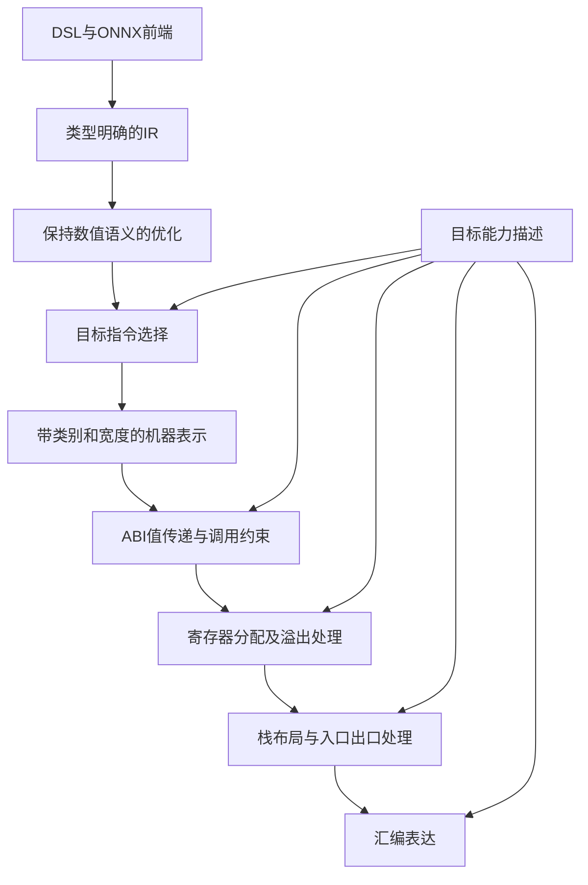

# 课题 28：扩展指令选择技术设计

扩展指令选择将带类型的 IR 转换为 RISC-V 机器指令。方案以数值类型为主线，连接前端解析、操作语义、机器表示、寄存器分配、内存布局和函数接口，使整数、单精度和双精度运算使用各自正确的数据通路。

## 设计目标与范围

设计面向 RV32 标量计算，覆盖 i32 的除法与余数，f32/f64 的四则算术与平方根，以及这些类型的最小值、最大值、取负、绝对值、访存、比较和条件分支。

整数运算采用 I/M 扩展，单精度和双精度浮点采用 F/D 扩展。函数接口以单个标量参数和单值返回为基础。软件浮点、向量化、通用张量布局和复杂参数传递属于独立的设计范围。

整体实现沿用“IR → 指令选择 → 寄存器分配 → 汇编表达”的编译流程。整数规则作为基础路径，浮点规则按明确的类型和目标能力接入；类型、值宽度和存储信息在各环节之间显式传递。

## 总体架构



各模块之间交换结构化信息。指令选择产生机器操作和操作数约束，分配器提供物理寄存器映射及溢出位置，栈布局计算函数内各存储位置的最终偏移，汇编层负责表达已确定的指令与地址。

下面用 Python 类型标注表达接口设计，签名中的省略号代表由相应模块实现的行为。`Sequence` 表示有序输入，`Mapping` 表示只读查询；类型、目标描述和跨阶段结果作为不可变数据传递。接口名称围绕模块职责组织，内部算法可以在保持这些合同的前提下调整。

| 模块 | 实现职责 | 向后续环节提供的信息 |
|---|---|---|
| 前端与类型系统 | 解析类型，归一化算子，构造合法 IR | 类型明确的值、操作和常量编码 |
| 目标能力描述 | 统一表达 ISA、ABI 和可用精度 | 操作可用性、寄存器类别与调用约束 |
| 指令选择 | 根据操作和类型选择指令或等价序列 | 机器指令、虚拟寄存器、常量引用 |
| 机器表示 | 描述指令的定义、使用及操作数要求 | 寄存器类别、值宽度、控制流和副作用 |
| 函数接口 | 接入参数、返回及调用位置约束 | 物理位置搬运、固定约束和调用覆盖集合 |
| 寄存器分配 | 安排物理寄存器，保存与恢复溢出值 | 寄存器映射、存储槽和寄存器保存需求 |
| 栈布局 | 布局局部数据和保存区，处理入口与出口 | 具体偏移、栈调整和寄存器保存/恢复 |
| 汇编表达 | 输出指令、函数边界及常量数据 | 符合目标语法的汇编 |

## 类型系统与前端处理

### 类型描述

类型描述包含数值类别、位宽、存储大小和自然对齐。位宽用于决定运算精度，存储大小和对齐用于安排常量、局部数据和溢出位置。

| 类型 | 数值表示 | 位宽 | 存储大小/对齐 | 数据寄存器类别 |
|---|---|---|---|---|
| i32 | 有符号整数 | 32 位 | 4/4 字节 | 通用寄存器 GPR |
| f32 | IEEE 754 binary32 | 32 位 | 4/4 字节 | 浮点寄存器 FPR |
| f64 | IEEE 754 binary64 | 64 位 | 8/8 字节 | 浮点寄存器 FPR |

地址采用 RV32 通用寄存器表示。访存操作显式关联元素类型，局部存储声明记录元素类型与数量；地址的机器表示和所指数据的精度分别处理。这样，指向 f64 数据的地址使用 GPR，而读写数据使用 FPR。

类型系统提供统一查询和常量编码接口：

```python
@dataclass(frozen=True)
class TypeInfo:
    dtype: DataType
    bit_width: int
    size_bytes: int
    alignment_bytes: int

@dataclass(frozen=True)
class ScalarConstant:
    dtype: DataType
    bits: int

def parse_dtype(name: str) -> DataType: ...
def type_info(dtype: DataType) -> TypeInfo: ...
def encode_literal(text: str, dtype: DataType) -> ScalarConstant: ...
def constant_from_bits(dtype: DataType, bits: int) -> ScalarConstant: ...
```

`parse_dtype` 接受 i32/int32、f32/float32、f64/float64，未知名称给出类型诊断。`type_info` 只返回本设计支持的三种数值类型的信息。`encode_literal` 将文本直接编码到声明精度，浮点文本采用 RNE，i32 文本要求处于有符号 32 位范围；编码后保存无符号位模式。`constant_from_bits` 接收已编码数据，要求 `0 <= bits < 2**bit_width`，不经过宿主浮点数转换，也不改变 NaN payload 或符号零。

### IR 构造规则

IR 构造集中使用操作签名来确定操作数和结果类型，前端仅负责将源表达式转换为相应操作。

| 操作 | 操作数要求 | 结果规则 |
|---|---|---|
| 加、减、乘、除、min、max | 两个同类型数值 | 继承操作数类型 |
| neg、abs | 一个数值 | 继承输入类型 |
| rem | 两个 i32 | i32 |
| sqrt | 一个 f32 或 f64 | 继承输入精度 |
| load | 地址及元素类型 | 元素类型 |
| store | 地址、元素类型及同类型数据 | 无数值结果 |
| 比较 | 两个同类型数值 | 逻辑结果，供条件分支使用 |

操作构造先确认类型签名，再创建结果值。不同类型不做隐式转换；改变精度需要明确的转换语义。函数参数和返回值也使用相同的类型描述。

浮点常量除类型外，还保留其 IEEE 编码。文本常量按声明精度编码，模型中的浮点常量保留源编码；数值展示和机器数据表达分别使用各自的信息。

### IR 构造 API

数值签名检查与指令构造分开：签名函数用于推导结果，构造器负责创建值、追加指令和维护函数/基本块归属。内存和控制流通过专门入口表达。

```python
def infer_numeric_result(
    op: OpCode, inputs: Sequence[DataType]
) -> DataType: ...

@dataclass(frozen=True)
class AddressRef:
    base: Value
    element_type: DataType

class IRBuilder:
    def new_function(
        self, name: str, params: Sequence[Value] = (),
        *, return_type: DataType | None = None,
    ) -> Function: ...
    def new_block(self, name: str) -> BasicBlock: ...
    def position_at_end(self, block: BasicBlock) -> None: ...
    def constant(self, literal: ScalarConstant) -> Value: ...
    def binary(self, op: OpCode, lhs: Value, rhs: Value) -> Value: ...
    def unary(self, op: OpCode, operand: Value) -> Value: ...
    def alloca(self, count: int, *, dtype: DataType) -> AddressRef: ...
    def load(self, address: AddressRef) -> Value: ...
    def store(self, address: AddressRef, value: Value) -> Instruction: ...
    def br(self, target: BasicBlock) -> Instruction: ...
    def br_compare(
        self, lhs: Value, predicate: ComparePredicate, rhs: Value,
        true_block: BasicBlock, false_block: BasicBlock,
    ) -> Instruction: ...
    def ret(self, value: Value | None = None) -> Instruction: ...
    def finish(self) -> Program: ...

def validate_ir(program: Program) -> None: ...
```

`DataType` 使用 INT32/FLOAT32/FLOAT64 三个枚举成员，`OpCode` 表达归一化操作，`ComparePredicate` 包含 EQ/NE/LT/LE/GT/GE 六种关系。`Value` 记录名称、数值类型和可选的 `ScalarConstant`；`Instruction` 记录操作、输入、结果及来源位置。`Function` 保存参数、返回类型、基本块和局部存储声明，`Program` 保存函数与全局值。

`binary` 和 `unary` 先调用 `infer_numeric_result`，检查元数、同类型要求和操作允许的类型，再构造结果；add/div/sqrt 等便捷方法委托这两个入口。类型不匹配时不创建结果，也不追加指令。`constant` 将编码与声明类型绑定，不能只保存用于展示的 Python 数值。

`alloca` 要求元素数量为正整数，在当前函数登记局部对象，生成标记为地址的 i32 基址，并以 `AddressRef` 携带元素类型；不新增通用指针类型。`load` 从元素类型推导结果，`store` 要求数据与元素类型相同。IR 中也保留该元素类型，后续环节无需从地址值的 i32 类型反推数据精度。地址角色仅能由地址构造操作产生，普通 i32 数值不能直接用于访存。

构造器拥有正在建立的 `Program`，每个值和跳转目标必须属于正确的函数。`new_function` 接收零个或一个尚未绑定函数的参数声明，将其绑定到新函数；返回类型为单个数值类型或无返回值，`ret` 与其声明一致。`new_block` 创建并选中当前函数中的块，`position_at_end` 切换到同一函数中可追加指令的块。基本块终结后不再追加指令，`br` 和 `br_compare` 通过块引用保存目标。`finish` 调用 `validate_ir` 并交出完整程序，之后构造器不再修改该程序；验证还检查定义与使用、控制流及地址元数据。前端来源位置随值和指令保留，供诊断使用。

### DSL 与 ONNX 归一化

DSL 常量允许显式指定 i32、f32 或 f64，未标注的常量采用 f32。后续运算由操作数类型决定精度。例如：

```text
x = const(1.5, dtype:f64)
y = const(2.0, dtype:f64)
z = add(x, y)
r = sqrt(z)
return r
```

这里的常量、加法、平方根和返回值均为 f64；精度在构造 IR 时确定，后端沿用该类型信息。

ONNX 的 INT32、FLOAT、DOUBLE 分别映射到 i32、f32、f64。前端先处理参数、initializer 和声明类型，再将标量 Add/Sub/Mul/Div/Sqrt/Min/Max 等操作转换为统一 IR。多输入 Min/Max 按输入顺序展开为同类型的二元操作；只有一个输入时直接传递该值。

标量形状在前端归一化后仍保留必要的元素类型。需要通用张量布局或广播的输入超出标量范围时，在进入目标选择前给出诊断。DSL 的 mod 归一化为 rem；ONNX 的算子按自身定义单独映射。

前端接口保持一致的 IR 输出：

```python
class DSLParser:
    def parse(self, text: str, filename: str | None = None) -> Program: ...

class ONNXParser:
    def parse(self, model_path: str) -> Program: ...
```

两个前端均通过 IR 构造 API 建立程序，在返回前完成类型和标量范围检查。DSL 文本常量调用 `encode_literal`，ONNX 已编码的浮点数据调用 `constant_from_bits`；ONNX 类型编号通过显式映射转换，未支持的编号给出诊断。多输入 Min/Max 的展开也调用 `binary`，使每一步继承相同的签名规则。

## 目标能力与数值语义

### 目标描述

编译入口建立一个目标描述，包含 ISA 扩展、ABI、浮点寄存器宽度和可用数值类型，并将其传给后端各模块。本设计采用以下目标组合：

| ISA | ABI | 浮点寄存器宽度 | 可用数值类型 |
|---|---|---|---|
| RV32IM | ILP32 | 无浮点寄存器 | i32 |
| RV32IMF | ILP32F | 32 位 | i32、f32 |
| RV32IMFD | ILP32D | 64 位 | i32、f32、f64 |

指令规则声明所需扩展。选择 f32 运算前确认 F 可用，选择 f64 运算前确认 D 可用；ABI 同时决定参数和返回值的传递方式。配置与运算不兼容时，在目标代码输出前停止转换。

目标描述由统一入口构造，派生属性不由调用方分别填写：

```python
def make_target(isa: str, abi: str) -> TargetSpec: ...

class TargetSpec:
    isa: str
    abi: str
    xlen: int
    flen: int
    abi_flen: int
    stack_alignment: int

    def require_operation(self, op: OpCode, dtype: DataType) -> None: ...
    def register_class(self, dtype: DataType) -> RegisterClass: ...
    def register_policy(self) -> RegisterPolicy: ...
```

`make_target` 规范化 ISA/ABI 名称，检查扩展依赖和组合，计算 XLEN、FLEN、ABI_FLEN 及栈对齐；无浮点时两个浮点宽度均为 0。`require_operation` 按操作、类型和所需扩展检查可用性。`RegisterClass` 只有 GPR/FPR，`register_class` 将数值类型映射到其中之一，地址固定使用 GPR。

`RegisterPolicy` 包含各类别的可分配集合、保留寄存器、调用者保存集合和被调用者保存集合，集合元素为带名称和类别的 `PhysicalRegister`。参数及返回寄存器按使用位置施加固定约束；栈指针等保留寄存器不参与普通值分配。同一个 `TargetSpec` 贯穿一次编译，不由各阶段再次推断目标。

### 整数与浮点语义

i32 采用固定位宽整数语义。除法向零截断，非零余数与被除数同号；除零和最小有符号整数除以 −1 的结果遵循 RV32M 定义，不额外插入陷阱。整数结果保持 32 位表示。

浮点四则算术与平方根显式采用 RNE，即最近值、相同距离取偶数。每次运算按其声明精度舍入，舍入选择作为机器指令的属性传递到汇编层。

min/max、符号操作和比较采用对应 F/D 指令的特殊值语义。min/max 对符号零、NaN 和 signaling NaN 的处理由目标规则定义；常量与访存保留源编码，计算结果及异常标志由实际浮点运算产生。

## 指令选择方案

### 选择流程

每条 IR 操作按以下顺序转换：取得操作与类型，确认目标能力，准备符合要求的操作数，再生成带类型信息的机器指令。规则使用操作本身及其操作数/结果类型，不依赖其他指令留下的类型状态。

简单运算直接通过“操作 + 类型”映射选择 opcode；需要展开的操作由对应规则生成等价序列。整数规则与浮点规则共享控制流、地址和函数结构处理，不为两种精度分别建立完整后端。

| IR 操作 | i32 | f32 | f64 |
|---|---|---|---|
| add/sub/mul/div | add/sub/mul/div | fadd.s/fsub.s/fmul.s/fdiv.s | fadd.d/fsub.d/fmul.d/fdiv.d |
| rem | rem | 类型不匹配 | 类型不匹配 |
| sqrt | 类型不匹配 | fsqrt.s | fsqrt.d |
| min/max | 有符号比较与值选择序列 | fmin.s/fmax.s | fmin.d/fmax.d |
| neg | 整数取负 | fneg.s | fneg.d |
| abs | 按符号选择原值或取负 | fabs.s | fabs.d |
| load/store | lw/sw | flw/fsw | fld/fsd |

整数 min/max 用有符号比较确定大小，再通过值选择序列取得结果，比较过程不依赖可能溢出的减法。整数 abs 按符号处理结果，最小有符号整数的结果仍按 32 位表示。

整数指令需要寄存器操作数时，常量先转换为 GPR 中的值；浮点数据先进入对应精度的 FPR。地址准备使用统一的寻址处理，再交给加载或存储规则。

指令选择按程序入口和函数内入口分工：

```python
@dataclass(frozen=True)
class SelectedModule:
    target: TargetSpec
    functions: tuple[MachineFunction, ...]
    constants: tuple[ConstantEntry, ...]

def select_program(program: Program, target: TargetSpec) -> SelectedModule: ...
def select_function(
    function: Function, target: TargetSpec, constants: ConstantPool
) -> MachineFunction: ...

class SelectionContext:
    def new_vreg(self, dtype: DataType) -> VirtualRegister: ...
    def new_address_reg(self) -> VirtualRegister: ...
    def materialize(self, value: Value) -> VirtualRegister: ...
    def emit(self, instruction: MachineInstruction) -> None: ...
```

`select_program` 接收已验证的 IR，建立本次编译专用的常量池，逐函数调用 `select_function`，最后返回 `SelectedModule`。其中 `functions` 为有序机器函数，`constants` 为冻结后的常量条目。`select_function` 保留函数签名、块间跳转、局部对象和来源位置，不将多函数压成丢失边界的指令列表。

每个 `SelectionContext` 属于一个函数，拥有 IR 值到虚拟寄存器/地址引用的映射、虚拟编号和输出块。`new_vreg` 由类型确定类别与宽度，`new_address_reg` 产生 32 位 GPR。`materialize` 将已有值或常量准备为其类型要求的寄存器，并在当前块追加必要指令；跨块复用必须满足定义支配使用，不能仅凭值名全局缓存加载结果。

操作规则先调用 `require_operation`，再按 `(op, dtype)` 分派。规则仅使用当前指令、目标和函数上下文；未支持的组合返回明确诊断，不生成默认指令。整数展开序列与浮点直接映射使用同一个 `emit`，每条产生的机器指令保留原 IR 的来源信息。

### 比较与条件分支

浮点比较先产生 GPR 中的 0 或 1，再由普通条件分支决定控制流。两种精度使用相同的谓词规则，仅选择不同的指令后缀：

| 谓词 | 浮点比较方式 | 分支条件 |
|---|---|---|
| a == b | feq(a, b) | 结果非零 |
| a != b | feq(a, b) | 结果为零 |
| a < b | flt(a, b) | 结果非零 |
| a > b | flt(b, a) | 结果非零 |
| a <= b | fle(a, b) | 结果非零 |
| a >= b | fle(b, a) | 结果非零 |

NaN 输入时，相等与有序比较为假，不等为真。feq 保持其 quiet comparison 语义，flt/fle 保持其 signaling comparison 语义；互换操作数构造大于或大于等于时沿用原指令的异常行为。

### 浮点常量

浮点常量集中放入只读常量区，以“类型与原始编码”作为标识，复用相同的常量。f32 以 4 字节数据表示，f64 以 8 字节数据表示，并分别满足自然对齐。

使用常量时，先取得 GPR 地址，再用 flw 或 fld 加载到 FPR。常量引用、标签和数据定义由同一常量管理模块生成，指令选择仅保存引用。

```python
class ConstantPool:
    def intern(self, literal: ScalarConstant) -> ConstantRef: ...
    def freeze(self) -> tuple[ConstantEntry, ...]: ...
```

`ConstantRef` 是池内唯一的符号引用；`ConstantEntry` 保存引用、类型、位模式、大小和对齐。`intern` 按 `(dtype, bits)` 去重，返回稳定引用；`freeze` 后不再接受新增条目。地址准备指令引用 `ConstantRef`，汇编层为相同引用生成唯一标签和数据定义。常量池作用域为一个模块，可被该模块的多个函数共享，不跨编译请求保留状态。

## 机器表示与寄存器分配

### 机器表示需要携带的信息

机器操作数区分寄存器、立即数、标签和内存引用。寄存器操作数同时记录类别和数值位宽；内存引用记录地址来源、元素类型或存储位置引用。局部数据和溢出位置在布局确定前使用符号引用。

每种机器操作声明结果定义、输入使用、操作数类别及是否涉及内存、调用、分支或浮点异常。分配器利用定义与使用计算活跃关系，汇编层利用操作数形式输出语法。

比较指令可以同时具有 FPR 输入和 GPR 输出，浮点访存也同时具有 GPR 地址和 FPR 数据，因此类别信息按操作数位置描述。

### 机器数据与指令描述 API

机器表示保留控制流结构，操作数中的引用由所属函数或模块管理：

| 数据对象 | 主要字段 | 约束 |
|---|---|---|
| `VirtualRegister` | id、reg_class、width_bits | id 在函数内唯一；f32/f64 分别为 32/64 位 FPR |
| `RegisterRef` | 虚拟或物理寄存器、使用宽度 | 表达单个寄存器操作数，类别与指令位置相符 |
| `StackSlotRef` | 函数内 slot_id | 局部与溢出槽共用唯一编号空间；布局前不保存数字偏移 |
| `StackSlot` | 引用、用途、size_bytes、alignment_bytes | 描述局部或溢出对象；大小与对齐明确 |
| `MemoryRef` | base、offset_bytes、element_type | base 为 `RegisterRef` 或 `StackSlotRef`；元素类型决定访问宽度 |
| `BlockRef` / `FunctionRef` | 所属函数内块 / 函数符号 | 分别用于分支目标和调用目标 |
| `MachineInstruction` | opcode、operands、rounding、origin | 操作数有序；舍入属性只用于支持它的指令 |
| `MachineFunction` | name、signature、blocks、locals | 保留函数签名、控制流及局部存储对象 |

`MachineOperand` 是寄存器引用、立即数、内存引用、常量引用或控制流符号引用的联合。比较结果用 32 位 GPR 表示 0/1；地址计算结果同样是 32 位 GPR，但访存数据精度由 `MemoryRef.element_type` 决定。局部地址计算和访存均保留 `StackSlotRef`，待布局阶段统一解析。

```python
def instruction_info(
    instruction: MachineInstruction, target: TargetSpec
) -> InstructionInfo: ...
```

`InstructionInfo` 返回寄存器定义、使用、逐位置操作数约束，以及读/写内存、写浮点异常标志、分支和调用等效果；调用还包含实际物理寄存器覆盖集合。每个 `OperandConstraint` 记录类别、宽度和可选的固定物理寄存器。分配器与机器优化共同使用该接口，指令打印字符串和注释不参与语义判断。`RoundingMode` 在本设计中使用 RNE，非舍入操作的 `rounding` 为 `None`。

### 分配与溢出

GPR 与 FPR 使用独立的可分配集合。f32 和 f64 共用一个 FPR 集合，不按精度划分互不相干的物理寄存器池；数值位宽用于决定搬运和溢出方式。

参数、返回、栈指针及其他 ABI 保留寄存器作为固定约束处理。分配器根据活跃关系安排其余物理寄存器，寄存器不足时选择值写入溢出位置，再在使用点恢复。

| 溢出值类型 | 槽大小/对齐 | 保存 | 恢复 |
|---|---|---|---|
| i32 | 4/4 字节 | sw | lw |
| f32 | 4/4 字节 | fsw | flw |
| f64 | 8/8 字节 | fsd | fld |

一个值对应稳定的溢出位置。分配策略可以采用不同的保留或驱逐方法，但共用值类别、槽布局和搬运规则，避免每种策略分别判断存储精度。

分配结果向栈布局提供溢出位置、所使用的被调用者保存寄存器，以及最终机器指令。跨块传递依照活跃关系处理，使每个后继块在使用值前能从正确位置取得数据。

```python
@dataclass(frozen=True)
class AllocationResult:
    function: MachineFunction
    register_map: Mapping[VirtualRegister, PhysicalRegister]
    spill_map: Mapping[VirtualRegister, StackSlotRef]
    spill_slots: tuple[StackSlot, ...]
    used_callee_saved: frozenset[PhysicalRegister]

def compute_liveness(function: MachineFunction) -> LivenessInfo: ...
def spill_recipe(dtype: DataType) -> SpillRecipe: ...
def allocate_registers(
    function: MachineFunction, target: TargetSpec,
    *, strategy: AllocationStrategy,
) -> AllocationResult: ...
```

`LivenessInfo` 提供各块的 live-in/live-out 及指令位置的活跃值，依据 `instruction_info` 和控制流计算。`SpillRecipe` 提供槽大小、对齐、保存 opcode 和恢复 opcode，各分配策略共用该查询。`AllocationStrategy` 包含 NAIVE/GREEDY/LINEAR，只选择分配算法，不改变类型规则、调用覆盖规则或栈槽格式。

`AllocationResult` 包含已改写的机器函数、未溢出虚拟值的物理映射、虚拟值到溢出槽的映射、溢出槽列表和使用的被调用者保存寄存器。分配过程保留局部槽引用，在其编号之外生成溢出槽引用，同一个虚拟值重复溢出时复用同一槽。改写结果包含保存/恢复及其临时寄存器分配，不再含待分配虚拟寄存器；局部和溢出地址仍为符号引用。

分配过程检查固定物理操作数的干涉，并处理调用覆盖集合。跨调用值可以分配到允许的被调用者保存寄存器，或按类型写入槽后恢复；两种选择遵守相同活跃规则。物理映射用于后续查询，机器函数中的改写结果是汇编生成的依据，后续阶段不再次从映射重做分配。

## 栈布局与调用约定

### 每函数布局

前端建立局部存储描述，分配器建立溢出描述，函数接口处理提供寄存器保存需求。栈布局统一收集这些信息，为每个函数计算独立的地址安排。

| 布局区域 | 安排方式 |
|---|---|
| 寄存器保存区 | 根据函数实际需要保持的寄存器生成 |
| 局部数据区 | 按元素数量、大小和对齐排列 |
| 溢出区 | 按各值的类型与对齐排列 |
| 填充区 | 使整个栈帧满足 ABI 对齐要求 |

各存储对象用同一种对齐分配规则安排：

```text
对象偏移 = 向上对齐(已使用字节数, 对象对齐)
已使用字节数 = 对象偏移 + 对象大小
栈帧大小 = 向上对齐(已使用字节数, ABI 栈对齐)
```

布局完成后，将机器表示中的栈位置引用替换为相对栈指针的偏移。栈调整和访存偏移满足目标指令的立即数范围；超出直接寻址范围的布局在汇编表达前给出诊断。

```python
@dataclass(frozen=True)
class RegisterSave:
    register: PhysicalRegister
    width_bits: int
    slot: StackSlotRef

@dataclass(frozen=True)
class FrameLayout:
    function_name: str
    size_bytes: int
    slot_offsets: Mapping[StackSlotRef, int]
    saved_registers: tuple[RegisterSave, ...]

def plan_frame(allocation: AllocationResult, target: TargetSpec) -> FrameLayout: ...
def finalize_function(
    allocation: AllocationResult, frame: FrameLayout, target: TargetSpec
) -> FinalMachineFunction: ...
```

`FrameLayout` 保存所属函数、总大小、`StackSlotRef → 字节偏移` 的映射和寄存器保存条目。`plan_frame` 汇总机器函数的局部槽、分配产生的溢出槽，以及被调用者寄存器和返回地址的保存需求，为保存条目另建不冲突的槽引用；所有槽均按调整后的 sp 为基准。各对象区间不得重叠，槽和整个栈帧分别满足自身与 ABI 的对齐。

寄存器保存条目记录物理寄存器、保存宽度和位置。GPR 按 XLEN 保存；硬浮点 ABI 的被调用者保存 FPR 按 ABI_FLEN 保存整个需要保持的寄存器状态，而值溢出仍按该值的 f32/f64 宽度安排。包含调用的函数按返回地址的活跃需求保存 ra。

`finalize_function` 用同一布局解析局部/溢出地址，加入入口栈调整、保存，以及每个返回出口的恢复和栈释放。它检查实际栈调整与每个最终访存偏移的可编码范围。结果 `FinalMachineFunction` 不含虚拟寄存器或栈槽引用，仅保留物理操作数和合法目标指令或伪指令；函数引用与常量符号留给汇编表达。

### 参数、返回与调用保护

入口将参数接入相应类别的虚拟值，返回处理将结果传到 ABI 规定的位置，搬运按数值精度选择：

| 类型 | 单个参数/返回寄存器 | 同类别搬运形式 |
|---|---|---|
| i32 | a0 | mv |
| f32 | fa0 | fmv.s |
| f64 | fa0 | fmv.d |

D 目标上的 f32 仍使用 4 字节内存表示，进入较宽浮点寄存器时遵循 NaN-boxing。按单精度执行加载和搬运，由目标指令建立正确的寄存器表示。

调用的机器语义声明可能被覆盖的寄存器。对处于调用者保存寄存器且跨调用仍活跃的值，在调用前保存，后续使用时按其类型恢复。函数自身使用的被调用者保存寄存器，在入口和每个返回出口分别保存与恢复。

函数入口统一分配栈帧，所有返回出口使用同一布局释放栈帧。栈指针在函数执行及调用边界保持 16 字节对齐。

函数接口约束在分配前显式进入机器表示，栈保存序列在布局后生成：

```python
@dataclass(frozen=True)
class ScalarSignature:
    param_type: DataType | None
    return_type: DataType | None

def scalar_abi(signature: ScalarSignature, target: TargetSpec) -> ABIContract: ...
def lower_abi(function: MachineFunction, target: TargetSpec) -> MachineFunction: ...
```

`ScalarSignature` 保存可选的参数类型和返回类型。`ABIContract` 返回参数/返回物理位置、按类型搬运形式、调用覆盖集合与栈对齐。零参数或无返回值对应空位置；不能将多个值悄悄压入单个位置。

`lower_abi` 保留原控制流，生成入口物理寄存器到虚拟值的搬运、返回值到规定位置的搬运，以及调用前后的参数/结果搬运。调用指令附带被调函数的 `ScalarSignature` 和覆盖集合；间接复杂参数传递不在此接口中扩展。固定位置只在这些使用点约束分配，不要求参数值在整个函数中一直占用 a0/fa0。该函数只处理值传递和调用约束，寄存器保存需求由分配及布局阶段确定。

## 优化与汇编衔接

整数常量折叠和等价变换使用统一的 32 位计算规则，包含除法与余数的边界行为。浮点算术保持声明精度的逐次运算，不以宿主语言结果直接替换目标运算。

优化器将浮点异常视为可观察行为。删除未使用的浮点计算、移动循环内计算或融合乘加时，需要同时保留执行条件、舍入次数和异常行为。只依据实数代数关系成立的变换不应用到本设计的浮点路径。

汇编层根据机器表示输出操作数类别、访存格式和舍入属性。四则浮点算术与平方根附加 rne；min/max、比较、符号操作和搬运按其各自的指令形式表达。

函数和基本块以不同角色管理，标签引用由对应符号生成。正文与只读常量分节表达，函数边界及大小信息从函数结构产生。后续汇编变换保留指令语义、数据区和符号引用。

```python
@dataclass(frozen=True)
class FinalMachineModule:
    target: TargetSpec
    functions: tuple[FinalMachineFunction, ...]
    constants: tuple[ConstantEntry, ...]

def emit_assembly(module: FinalMachineModule) -> str: ...
```

`FinalMachineModule` 包含目标描述、有序的 `FinalMachineFunction` 和冻结的常量条目。`emit_assembly` 检查操作数类别、舍入属性和符号引用是否满足目标形式，再输出函数、基本块、指令与只读数据；不补做指令选择、分配或栈布局。模块内每个引用有唯一符号身份，函数大小仅覆盖其代码范围。返回值为完整汇编文本，文件写入由编译入口负责。

## 编译入口与调用顺序

扩展路径提供一个接收类型明确 IR 的入口：

```python
def compile_ir(
    program: Program, *, target: TargetSpec, strategy: AllocationStrategy
) -> str:
    validate_ir(program)
    selected = select_program(program, target)
    functions = []
    for function in selected.functions:
        abi_function = lower_abi(function, target)
        allocation = allocate_registers(abi_function, target, strategy=strategy)
        frame = plan_frame(allocation, target)
        functions.append(finalize_function(allocation, frame, target))
    module = FinalMachineModule(
        target=target, functions=tuple(functions), constants=selected.constants,
    )
    return emit_assembly(module)
```

IR 优化在该入口前执行，并在优化后的 IR 上重新验证类型与结构。各后端阶段接收上一阶段的结构化结果，返回新的结果，不改写调用方的 IR，也不复用上一函数的分配或栈布局状态。IR 构造器、常量池、函数选择上下文和分配过程在各自作用域内维护可变状态；交出的跨阶段结果不再由生产者修改。

例如，用 f64 常量构造除法与平方根，类型经以下接口传到目标代码：

```python
builder = IRBuilder()
builder.new_function("compute", return_type=DataType.FLOAT64)
builder.new_block("entry")
x = builder.constant(encode_literal("9.0", DataType.FLOAT64))
y = builder.constant(encode_literal("4.0", DataType.FLOAT64))
quotient = builder.binary(OpCode.DIV, x, y)
result = builder.unary(OpCode.SQRT, quotient)
builder.ret(result)
assembly = compile_ir(
    builder.finish(),
    target=make_target("rv32imfd", "ilp32d"),
    strategy=AllocationStrategy.LINEAR,
)
```

该调用序列中，IR 保留 f64 类型，选择得到双精度运算及常量引用，函数接口约束返回位置为 fa0，分配和布局完成寄存器及存储安排，汇编表达输出已确定的目标形式。

### 错误与诊断接口

模块在不能满足输入合同的位置抛出 `CompileError` 的具体子类，每个异常携带 `Diagnostic`。诊断记录阶段、消息，以及可获得的源文件/行列、函数、块和操作；机器指令通过 `origin` 延续 IR 来源。

| 错误类型 | 触发位置 | 诊断内容 |
|---|---|---|
| `IRValidationError` | 类型解析、常量编码、IR 构造与验证 | 未支持类型、错误元数、混合精度、地址/返回类型或标量范围不合法 |
| `TargetConfigError` | `make_target` | ISA、扩展依赖或 ABI 组合不合法 |
| `UnsupportedLoweringError` | 操作可用性检查及目标选择 | 操作与类型组合未支持，或目标缺少必要扩展 |
| `RegisterAllocationError` | 分配与溢出改写 | 固定寄存器约束或临时寄存器需求无法满足 |
| `FrameLayoutError` | 栈布局和最终地址解析 | 布局对象不合法，栈调整或访存偏移超出直接编码范围 |
| `MachineValidationError` | 机器信息查询及汇编表达 | 操作数类别、舍入属性、符号引用或阶段结果不合法 |

构造 API 在失败前不追加该条指令，后端阶段失败时不交出部分结果。异常由外层编译入口统一转换为用户诊断，内部模块不吞掉异常、默认切换精度或把失败当作空输出。完整汇编文本生成后再执行输出写入，避免类型或目标错误留下半份文件。

## 实现依赖与顺序

实现按数据依赖推进，使每一步建立的表示能被下一步直接使用：

1. 建立数值类型描述和操作签名，完成 DSL/ONNX 到类型明确 IR 的归一化；同时确定整数与浮点数值语义。
2. 接入统一目标描述，整理整数选择规则，补充余数与整数值选择；整数常量处理沿用相同的 32 位语义。
3. 扩充机器操作数的类别和宽度信息，加入常量引用；据此完成 f32/f64 算术、访存和比较规则。
4. 将参数、返回及调用约束接入机器表示，再将寄存器类别、活跃关系和按类型搬运接入分配过程，形成统一的溢出位置描述。
5. 汇总局部数据、溢出及寄存器保存需求，完成每函数栈布局、入口出口和最终地址解析。
6. 将目标选择、分配、布局及汇编表达连接为一条编译路径，并将类型与浮点语义约束传递给前后各类优化。

## 规范依据

- [RISC-V M 扩展](https://raw.githubusercontent.com/riscv/riscv-isa-manual/main/src/unpriv/m-st-ext.adoc)：整数除法、余数及边界语义。
- [RISC-V F 扩展](https://raw.githubusercontent.com/riscv/riscv-isa-manual/main/src/unpriv/f-st-ext.adoc)：单精度运算、舍入、比较及浮点异常。
- [RISC-V D 扩展](https://raw.githubusercontent.com/riscv/riscv-isa-manual/main/src/unpriv/d-st-ext.adoc)：双精度运算和较窄浮点值的寄存器表示。
- [RISC-V psABI](https://riscv-non-isa.github.io/riscv-elf-psabi-doc/)：参数、返回、寄存器保存责任和栈对齐。
