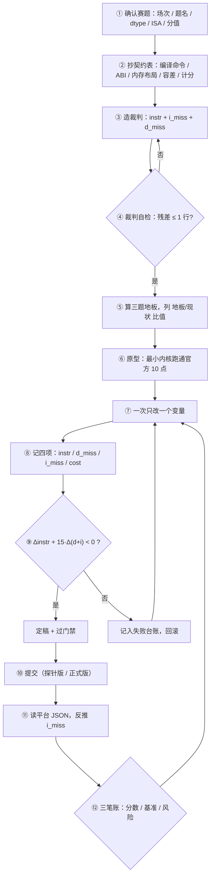
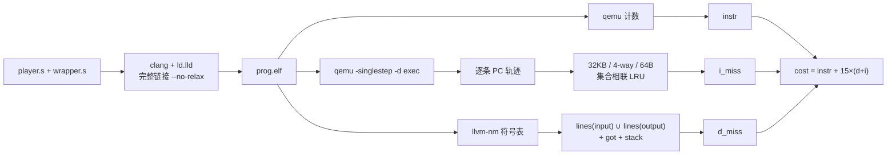
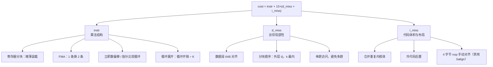
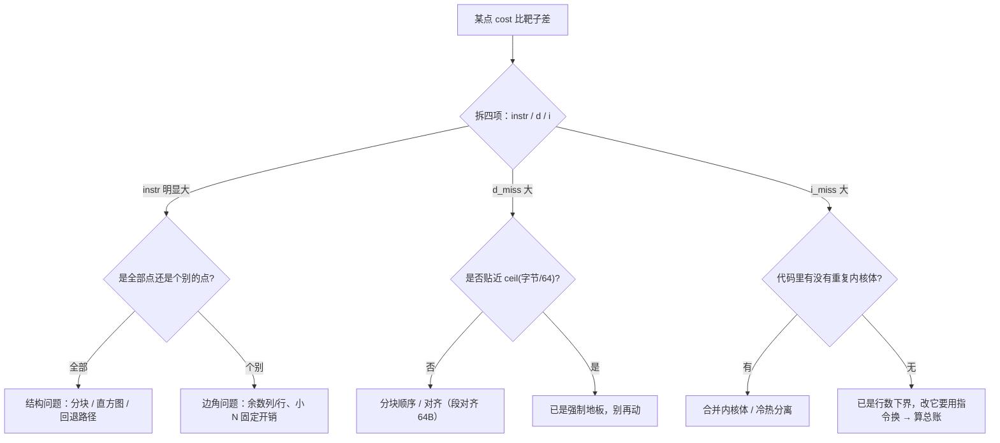
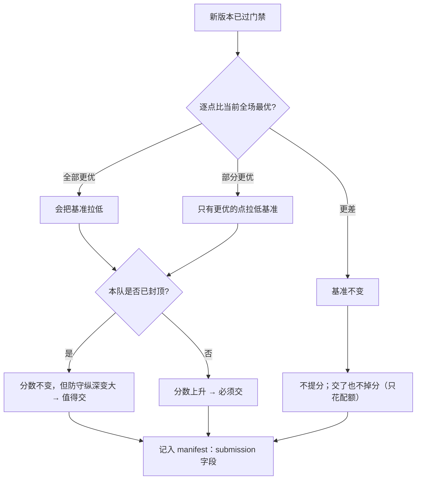

# 算子内核优化（二）· 从零到打榜的完整手册

> **这份文档给谁看**：没打过性能比赛、也没做过编译器优化的同学。
> **和 `OPTIMIZATION.md` 的分工**：那份是"旋钮台账"（做完之后查：哪个入口还能拧、现在差多少）；
> 这份是"教学手册"（动手之前读：这个比赛在比什么、怎么造裁判、怎么找地板、怎么迭代、怎么不踩坑）。
> **数据来源**：所有数字都来自本机实测（`qemu` 计数 + 单步轨迹 + ELF 符号模型），
> 比赛侧产物与报告在 `how2work_2/`，框架侧代码在 `scratchv/backend/kernels/`。
> **复现要求**：本文所有数字为**确定性结果**（同一工具链、同一链接方式重跑应完全一致）；
> 若不一致，先怀疑工具链版本或链接参数变了，不要怀疑"抖动"。

---

## 阅读指南

| 你是谁 | 建议路线 | 预计耗时 |
|---|---|---|
| 完全新手（没写过汇编） | 第 0 → 1 → 2 → 3 章，然后跑通附录 B 的最小例子 | 半天 |
| 会写 C、想打榜 | 第 1 → 2 → 4（路径选择）→ 5 → 6 → 7 章 | 一天 |
| 没学过编译原理 | 先读 **§3.6–§3.10**（编译器优化基础 + 实测对照），再回主线 | 加半天 |
| 想补方法论 | **§2.7**（三个层次 / Amdahl / 微基准陷阱）+ 附录 E（工具速查） | 两小时 |
| 已经在做，卡住了 | 第 8 章（失败台账）→ 第 9 章（会骗你的数字）→ 第 10 章（归因） | 两小时 |
| 准备提交 | 第 11 章（提交前 12 条）+ 附录 A（复现卡） | 半小时 |

> 一句话总纲：**模型先行 → 测量先于优化 → 单一案例逐版本对照 → 失败也要记账 → 提交也是一次实验。**

### 图索引

| 图 | 位置 | 回答什么问题 |
|---|---|---|
| 图 1 · 全流程闭环 | §1.5 | 从拿到赛题到提交，一共几步、哪一步能回头 |
| 图 2 · 裁判数据流 | §2.2 | `instr / d_miss / i_miss` 三个数分别从哪条管线出来 |
| 图 3 · 分块几何 | §5.3 | 4×4 分块到底在算哪 16 个输出、复用了什么 |
| 图 4 · 任意 N 的三段切分 | §6 T3 | 非 4 倍数的 N 怎么被切成主块/右带/底带 |
| 图 5 · 三项分解与手法 | §7 开头 | 差距落在哪一项、对应哪组手法 |
| 图 6 · 归因决策树 | §10.2 | 发现某个点慢了，先看哪一项 |
| 图 7 · 提交决策树 | §10.3 | 什么情况下"交了不加分但仍值得交" |

> 图用 Mermaid 写（GitHub / 主流 IDE 插件可渲染）；**若你的查看器不渲染，按代码块里的文字读即可**，
> 每张图下面都配了一行不依赖渲染的文字说明。

---

# 第 0 章 · 先记住三个数字

新手最容易犯的错，是把"优化"理解成"让代码变短"。在这场比赛里，**代码变短经常不加分，甚至扣分**。
先把三个可换算的数字刻进脑子：

| 数字 | 含义 | 换算成什么 |
|---|---|---|
| **64 字节** | 一条缓存行 | 一次 `d_miss`（或 `i_miss`）= 这一行第一次被碰到 |
| **15** | miss 的权重 | **一次 miss = 15 条指令**。为了少 1 行 miss，多写 14 条指令都划算 |
| **16 条** | 一条 64B 行能装多少条指令 | 4 字节/条；所以"热循环长了 3 条指令"≈"可能多占 1 行" |

由此推出两个反直觉结论，全文都会反复用到：

1. **指令数不是唯一目标**。`cost = instr + 15×(d_miss + i_miss)`。少 100 条指令收益 100；少 1 行 miss 收益 15；而多 20 条冷代码可能只多 1 行（−15）——**要算总账**。
2. **循环体变长是乘法代价，代码段变长是加法代价**。循环体里每加一条指令，跑 N 次就多 N 条；而一段只执行一次的冷代码，多 70 条也只值 ~4 行 i_miss。

---

# 第 1 章 · 这场比赛到底在比什么

## 1.1 交付物

你交的是**一个 `.s` 汇编文件**，里面必须有一个全局符号 `cnn_entry`：

```asm
    .option norvc          ; 禁止压缩指令：任何 2 字节指令 = 整题 0 分
    .option norelax
    .text
    .balign 4
    .globl cnn_entry
    .type cnn_entry, @function
cnn_entry:                 ; a0 = 输入首址, a1 = 输出首址, a2 = N
    ...
    ret
```

平台自己生成 `wrapper.s`（负责摆内存、灌输入、调你的函数、把输出 dump 出来），
再用固定命令把你的文件和它链在一起：

```bash
clang --target=riscv32-linux-gnu -march=rv32imf -mabi=ilp32 \
      -nostdlib -static -fuse-ld=lld -Wl,--no-relax wrapper.s player.s -o prog.elf
```

**为什么 `--no-relax` 和固定 `-march` 很重要**：这是比赛方为了让"指令数"跨队可比而锁死的。
你自己本地复现时也要用同一条命令，否则数字没有意义。

## 1.2 目标函数

```
cost = 动态执行的指令数 + 15 × (d_miss + i_miss)
```

三项的物理含义（第 3.4 节会细讲）：

| 项 | 含义 | 谁决定 |
|---|---|---|
| `instr` | 真正执行了多少条指令 | 你的算法结构、分块、展开、分支 |
| `d_miss` | 数据侧：碰过多少条**没碰过的** 64B 行 | 数组大小、分块顺序、地址对齐 |
| `i_miss` | 指令侧：执行到的代码覆了多少条 64B 行 | **代码体积与布局**（不是执行次数！） |

## 1.3 计分是相对的

```
逐点得分 = 该点满分 × min(1, 全场最优 cost ÷ 本队 cost)
```

三题分别为 30 / 30 / 40 分，每题 10 个数据点，每点分值相同。

**这张式子决定了整场比赛的策略**，推导出三条推论：

1. **封顶**：你是全场最优时，比值恒为 1，**再快一分不加**。所以"领先 2 倍"和"领先 0.1%"同分。
2. **基准动态**：任何人提交更优值，全场基准下降，所有人的分按新基准重算。
   ⇒ **把基准拉低 = 提高后来者门槛**，这就是"防守"的严格定义。
3. **无沉没成本**：榜单按题取该队**历史最好**的一次提交 ⇒ 交一次更差的版本不掉分
   （代码依据：平台 `standings.py` 对每题取各次提交分数的最大值）。

> 新手最常见的误解：以为"我比昨天快 30% 就该加 30% 的分"。
> 实际上只有"从落后变成领先"或"从领先变成更领先（无用）"两种结局。

## 1.4 你在哪：一张定位图

业界讲性能喜欢用 Roofline（"算力上限 vs 带宽上限"）把人钉在二维图上
（Williams/Waterman/Patterson, CACM 2009, <https://dl.acm.org/doi/10.1145/1498765.1498785>）。
我们的"图"就是三项分解，问题永远是：**这次差距落在哪一项？**

```
差在哪一项？ ── instr 大 ──→ 结构问题（分块/展开/多余的指令）  ← 收益 10%~400%
            ├─ d_miss 大 ─→ 访存局部性（分块顺序/对齐）
            └─ i_miss 大 ─→ 代码体积与布局（合并/冷热分离/对齐）
```

**判据**：`15×(d+i) / cost` 的占比。
本次实测里它从 2%（大 N matmul）到 63%（N=4）不等——**占比高就先修 miss，占比低就先修指令**。

## 1.5 全流程闭环（图 1）



**读法**：能"回头"的只有三处——`③→②`（裁判不准就重造）、`⑧→⑦`（不划算就回滚）、`⑫→⑦`（提交是下一轮的输入）。
其余每一步都必须一次做对，因为后面全建立在它上面（**尤其是第 ②③ 步**）。

---

# 第 2 章 · 先造裁判（否则一切免谈）

## 2.1 为什么必须自己造

平台的评测器只回一个总 `cost`（和 `d_miss`），**不告诉你 `i_miss`，也不告诉你三项怎么拆**。
你在本地改一行、猜"应该快了吧"，然后提交——这叫赌博，不叫优化。

Knuth 那句话经常被截断成"过早优化是万恶之源"。原文的完整意思是：
**"97% 的情况下该忘掉小效率……但不要放过那关键的 3%"，理由是"程序员的直觉猜测普遍是错的，只有用测量工具才知道哪里是关键"**
（Knuth, *Structured Programming with go to Statements*, 1974,
<https://cs.sjsu.edu/~mak/CS185C/KnuthStructuredProgrammingGoTo.pdf>）。

## 2.2 三个量怎么测

| 量 | 办法 | 精度 | 注意 |
|---|---|---|---|
| `instr` | `qemu-riscv32` 计数（或 `-d exec` 数轨迹行数） | 精确 | 要把 wrapper 的指令也算进去（它也要执行） |
| `i_miss` | `qemu -singlestep -d exec` 拿**逐条执行的 PC**，再喂给 32KB/4-way/64B 的集合相联 LRU | **精确** | 见 2.3 |
| `d_miss` | 拿不到硬件计数器 ⇒ 用 ELF 符号地址算"数组覆盖了哪些 64B 行" | ±1 行 | 见 2.4 |

**图 2 · 三个数分别从哪条管线出来**



**读法**：三条腿共用同一个 `prog.elf`——所以**换了链接方式，三个数会同时变**。
这也解释了为什么"只改源码不重链接"什么都测不出来（§9 第 2 条）。

## 2.3 为什么 `i_miss` 能精确复刻

平台的插桩逻辑是：**每个翻译块（TB）执行时，按顺序把它里面每条指令的虚拟地址喂给 I-cache 模型**。
而 `qemu -singlestep -d exec` 输出的恰好就是"按顺序执行的每一条指令 PC"——**两个序列完全一致**。
于是：**同样的序列 + 同样的 LRU 参数 ⇒ 同样的 miss 数**。这不是近似，是复刻。

新手要记住的推论：`i_miss` **不是"取指次数"**。循环跑一百万次，只要代码占 5 行，`i_miss` 就是 5。
它只数"**被执行到过的、不同的行**"。

## 2.4 为什么 `d_miss` 必须有"相位"

早期用固定公式：`d_miss = ceil(输入字节/64) + ceil(输出字节/64) + 5`。它错在**看不见对齐**：

```
数组从 64B 边界开始，长度 256B  → 覆盖 4 行
数组从边界+52 字节开始，长度 256B → 覆盖 5 行（首尾各跨一行）
```

正确做法（本项目 `dmiss.py` 的做法）：

```
d_miss = | lines(input, 4·IN) ∪ lines(output, 4·OUT) |  + got_lines + stk
lines(addr, bytes) = { addr//64 … (addr+bytes-1)//64 }      # 带相位，不是简单向上取整
```

三个要点，缺一个就会算错：

1. **按字节算**：matmul 的输入是 `2N²` 个 float，套 add 的公式会差 300+ 行；
2. **求并集去重**：小 N 时输入和输出可能落在同一行，不能重复计；
3. **常数要能解释**：`got_lines` 来自 wrapper 的 `la` 指令（`--no-relax` 下是 `auipc + lw`，真会读 `.got` 段）；
   `stk` 来自 `sp` 指向的栈区。它们是机制，不是拟合出来的魔法数。

> **实测对照**：旧固定公式对三题分别**高估 1.8 / 2.7 / 3.0 行**（即把你的成绩算得比实际更差、偏悲观）；
> 相位模型 25/30 个点的残差 ≤1 行。方向别记反：公式法的毛病是**高估 d_miss**。

## 2.5 裁判自检

在相信任何优化结论之前，先跑一次"裁判 vs 平台真值"的对照：

| 指标 | 可用门槛 |
|---|---|
| 逐点 `d_miss` 残差 | ≥8/10 个点在 ±1 行内 |
| 逐点 `instr` | 与平台**完全一致**（不一致说明不是同一份产物） |
| `cost` 复算 | `instr + 15×(d+i)` 必须逐点等于你报的数 |

**最隐蔽的一个坑**：残差变大，常常不是模型错，而是**你比较的两个东西不是同一份产物**
（平台真值来自上一版提交，你手里已经是改过的版本）。诊断法：把数据段基址整体平移 1 字节重算，
如果残差全部回到 ±1，就是相位问题。

## 2.6 复现卡（每个实验都要贴一张）

参考 ACM 的可复现性定义与 SIGPLAN 的"足够信息"清单
（<https://www.acm.org/publications/policies/artifact-review-and-badging-current>、
<https://sigplan.org/Resources/EmpiricalEvaluation/>），本文要求每个实验小节都带这六行：

```
① 工具链：clang/ld.lld/qemu 版本号
② 编译：完整命令（含 -march / -mabi / --no-relax / 是否 -static）
③ 评测：harness 版本 + 命令 + N 集合 + 输入初值/种子
④ 结果：instr / d_miss / i_miss / cost 四个数（缺一项不算）
⑤ 产物：objdump 得到的 cnn_entry 起址、.text 长度、是否全 4 字节
⑥ 判定：靶子值是多少、本次是赢还是输、误差允许多少
```

## 2.7 性能分析方法论：三个层次、两种方向

新手最容易"一上来就改代码"。专业做法是先分层，再定向。

| 层次 | 问什么 | 用什么 | 什么时候做 |
|---|---|---|---|
| **L1 总量** | 这个点比靶子差多少？值得做吗？ | `cost / 靶子` | 每轮开始 |
| **L2 分解** | 差在 `instr`、`d_miss` 还是 `i_miss`？ | 四项分解表 | 决定方向 |
| **L3 定位** | 是哪几个点？哪一段代码？ | 逐点表 → 反汇编 | 决定改哪行 |

**两种分析方向，用途不同**：

| 方向 | 做法 | 适合回答 | 本项目用法 |
|---|---|---|---|
| 自顶向下 | 先看总量，再逐层拆 | "系统整体瓶颈在哪" | 主线：每轮先算 L1/L2 |
| 自底向上 | 写微基准，单点验证假设 | "这个改动到底有没有效" | 只用来验证单个假设（例如"多累加器有没有用"） |

### 2.7.1 三个必须遵守的实验纪律

1. **控制变量**：一次只改一个。改两处，变快了也不知道是哪处带来的，更没法叠加。
2. **A/B 对照**：任何"更快"都必须有一个"改前"的实测数字，不能凭感觉。
3. **确定性口径**：本比赛的 `cost` 是确定性的（同一工具链、同一链接方式重跑应**逐位相同**）。
   所以"看起来有波动"一律要解释成**布局差异**，而不是噪声。这条比一般性能工程更严格，
   也是本项目敢用"1 条指令"为单位做决策的原因。

### 2.7.2 Amdahl 定律：为什么"优化了 2 倍"可能等于没优化

```
总加速 = 1 / ((1 − p) + p/s)
        p = 被优化部分占总代价的比例
        s = 该部分的加速倍数
```

本项目算例：matmul 里 `instr` 占 `cost` 的 98%（大 N），`d_miss+i_miss` 只占 2%。
所以"把 miss 从 20 行降到 10 行"（−150 cost）在一百万级的 cost 面前 **≈0.03%**——
**占比低的那一项，再优化也看不见。**（150 / 515,818 ≈ 0.03%）

反过来：小 N（N=4）时 `15×miss` 占 45%，此时"少 1 行"就非常值钱。
**同一个手法在不同数据点上的价值差 100 倍**，这就是为什么必须先算占比。

### 2.7.3 Roofline 的一句话版本

Roofline 把程序钉在"算力上限 / 带宽上限"的二维图上，回答"你被哪个卡住"。
本比赛没有时间维度，所以对应的二维是：

```
                  cost
                 /
    instr ──────┘     ← 结构受限：改算法结构
    miss  ──────┐     ← 访存/布局受限：改顺序与对齐
```

**判据**：`15×(d+i) / cost`。> 20% 先修 miss，< 5% 先修指令，中间看哪边更容易。

### 2.7.4 微基准会骗你的三种方式

| 陷阱 | 现象 | 本项目形态 |
|---|---|---|
| 结果没被使用（DCE） | 测出来"快到不真实" | 只跑 `clang -c` 的 objdump 数指令，测的不是最终产物 |
| 测量装置本身有成本 | 测出来的差值其实是工具的 | 用"加 5 条 nop"去换 1 行 miss，结果那 5 条本身被执行 |
| 缓存预热/冷启动混淆 | 第二次跑更快 | 只在同一个进程里连跑两次对比，忘了每次都是冷缓存 |

（DCE 的经典演示见 Shipilev 的 JMH 系列：<https://shipilev.net/jvm/anatomy-quarks/>；
测量偏差的系统研究见 Mytkowicz 等，ASPLOS'09。）

---

# 第 3 章 · 最小必备知识（只讲这个比赛用得到的）

## 3.1 指令集：`rv32imf` 意味着什么

| 字母 | 含义 | 你会用到 |
|---|---|---|
| `i` | 基础整数指令 | `lw/sw/add/addi/slli/mul/blt/bne/jal/jalr` |
| `m` | 乘除法 | `mul`（我们基本用不到，见下） |
| `f` | 单精度浮点 | `flw/fsw/fadd.s/fmul.s/fmadd.s/fmv.w.x` |

**关键**：`f` 里有 **`fmadd.s rd, rs1, rs2, rs3`（rd = rs1×rs2 + rs3）**——一条指令完成"乘加"。
这是 fp32 相对定点最大的红利：定点要 `mul` + `srai` + `add` 三条，浮点只要一条。

**禁止**：`c.*`（压缩指令，2 字节）、`f*.d`（双精度）、原子指令。
判据不是"我用了没有"，而是**反汇编逐条看**（见 3.3）。

## 3.2 ABI：只有三个寄存器要记

```
a0 = 输入张量首址
a1 = 输出张量首址
a2 = N（规模，运行时才知道）
```

三题的内存布局（比赛方保证）：

```
add-fp32:      A[0..N) 紧跟 B[0..N)         → 输入 2N 个 float
matmul-fp32:   A[N×N) 紧跟 B[N×N)           → 输入 2N² 个 float，输出 N×N
reduesum-fp32: X[0..N)                      → 输入 N 个 float，输出 1 个
```

**"尺寸无关"是硬要求**：N 由 `a2` 给出，你不能假设它等于某个值。官方 10 个点的 N 是固定的，
但代码必须对任意 N 正确（包括 0、1、3 这类边角）。

## 3.3 汇编 → 目标文件 → 链接 → 反汇编

新手最容易跳过这一步，然后被线上打脸：

```bash
# ❌ 只做这一步，抓不到两类致命问题
clang --target=riscv32-linux-gnu -march=rv32imf -mabi=ilp32 -c kernel.s -o kernel.o

# ✅ 必须完整链接（分支越界、重定位、对齐填充都在链接期才暴露）
clang --target=riscv32-linux-gnu -march=rv32imf -mabi=ilp32 \
      -nostdlib -static -fuse-ld=lld -Wl,--no-relax wrapper.s kernel.s -o prog.elf

# ✅ 逐条确认都是 4 字节（--mattr 必须给，否则浮点指令会显示 <unknown>）
llvm-objdump -d --mattr=+m,+f,+c prog.elf | grep -c ' ^[0-9a-f]*: [0-9a-f]\{4\} '   # 期望 0
```

**为什么 `-c` 不够**：条件分支的跳转范围只有 ±4KB。你的 `.s` 单独汇编永远合法，
但和 wrapper 链在一起后，`beq` 可能跳不到目标——**只有链接器会报**。比赛一就因此在线挂过一次。

## 3.4 缓存：`d_miss` 与 `i_miss` 的真实含义

题目给的 L1：**32KB / 4 路组相联 / 64B 行**。

- 一条 64B 行装 **16 个 float**（或 16 条 4 字节指令）；
- **冷启动 miss**：一行第一次被访问，算 1 次；
- **容量 miss**：工作集超过 32KB 后，老行被挤掉、再访问又算 miss；
- **冲突 miss**：地址映射到同一组的行太多。

`d_miss` = 数据侧被碰过的不同行数（含容量/冲突）；`i_miss` = 代码侧被**执行到**的不同行数。

> 经验值（本项目实测）：线性扫描一个数组时，`d_miss ≈ 字节数/64`，这就是**地板**；
> 分块算法如果顺序对，能贴着地板；顺序错，会出现 4~5 倍的抖动（经典的"容量悬崖"）。

## 3.5 浮点：为什么能"换累加次序"

题目给的是**容差比对**：

```
|got − exp| ≤ atol + rtol·|exp|      rtol = 1e-4
atol: add / matmul = 1e-3，reduesum = 1e-2
```

这意味着：**你可以重排累加顺序、可以分块、可以用 FMA**（FMA 会改变舍入）。
而定点（int32 逐位比对）的题目**不允许**任何重排——这是两套完全不同的解法空间。

⚠️ 但"允许舍入差"≠"允许错"。累加次序换来换去，误差会累积，**必须用官方容差实测**，
不能靠"看起来对"。

## 3.6 编译器优化在做什么（把术语变成"影响哪个数"）

**定义**：编译器优化 = 在**保持语义**的前提下改写程序，使某个**目标函数**变小。
关键在最后五个字：**目标函数不同，最优代码就不同**。编译器默认最小化"估计的周期数"，
本比赛最小化 `instr + 15×(d+i)` —— 两者经常冲突（§3.10 有实测）。

### 3.6.1 优化分两类

| 类别 | 关心什么 | 典型变换 | 本题对应哪个数 |
|---|---|---|---|
| **机器无关** | 程序结构 | 常量折叠/传播、公共子表达式消除（CSE）、死代码消除（DCE）、内联、循环不变量外提、强度削弱、循环展开/交换/分块 | `instr` |
| **机器相关** | 具体指令与寄存器 | 指令选择、**寄存器分配**、指令调度、窥孔优化、分支松弛（长跳）、对齐填充 | `instr`（分配失败会 spill）、`i_miss`（布局） |

### 3.6.2 五个必须知道的中间概念

| 概念 | 一句话 | 为什么打榜要知道 |
|---|---|---|
| 基本块（basic block） | 一段"进来必走到底、中间没有分支"的指令 | 循环体就是最大的基本块；它的长度直接决定 `i_miss` |
| 控制流图（CFG） | 基本块 + 跳转边 | 决定"哪段代码会被执行到"——`i_miss` 只算被执行的行 |
| 数据流分析 | 到达定值、活跃变量、可用表达式 | 寄存器分配、CSE 的底层；也解释"为什么编译器要 spill" |
| SSA | 每个变量只赋值一次 | 现代编译器的主流形式；理解它才知道为什么"多累加器"是编译器的常规操作 |
| 窥孔优化（peephole） | 在几条指令的窗口内做局部替换 | 手工优化最常用的层面（例如 `addi x,x,0` 删除） |

### 3.6.3 最关键的一条结论

**你知道的信息比编译器多。** 编译器看不到：

- L1 的具体参数（32KB / 4-way / 64B）；
- 评分权重（一次 miss 抵 15 条指令）；
- 数据点的 N 集合与分布；
- 反汇编闸门（"必须全 4 字节"这种非标准约束）。

所以**手写在本题稳定赢编译器**——不是一个数量级的技巧，而是"信息优势 + 目标函数对齐"。
§3.10 给出实测：`-O3` 在本题比手写差 1.9~3.7 倍。

## 3.7 循环变换与分块：本题的绝对主线

几乎所有收益都来自循环层，因为**循环是唯一"重复执行"的地方**。

| 变换 | 做什么 | 收益 | 代价 |
|---|---|---|---|
| 不变量外提（LICM） | 把循环内不变的计算搬到外面 | `instr` | 无 |
| 强度削弱 | 用加法代替乘法（`i*n` → 指针自增） | `instr` | 多占寄存器 |
| 展开（unroll） | 循环体复制 K 份 | `instr`（循环开销 ÷ K） | `i_miss` ↑ |
| 交换（interchange） | 调换循环顺序 | `d_miss`（局部性） | 可能破坏依赖 |
| 分块（tiling） | 把大循环切成小块 | `d_miss` + 寄存器复用 | 代码变复杂、边角处理 |
| 融合/分裂/倾斜 | 合并或拆分循环 | 视情况 | 视情况 |

### 3.7.1 依赖：能不能交换的判据

**只有当两个迭代之间没有数据依赖时，才能交换顺序。**
例如 `C[i][j] = Σ A[i][k]·B[k][j]`：每个输出 `C[i][j]` 只被自己的 `(i,j)` 写，
所以 `i/j/k` 三个循环可以任意重排——这就是为什么能把 `k` 放到最内层（让 B 的列块复用）。

反例：`x[i] = x[i-1] + a[i]` 有跨迭代依赖，绝不能交换或并行。

### 3.7.2 两级分块：寄存器级 与 缓存级

```
寄存器级 tile（mr×nr）：让"装载"被 mr·nr 个乘加摊薄
缓存级 tile（工作集）：让当前处理的块能装进 32KB
```

**工作集算例**（matmul，4×4 tile，N=64）：

```
一个 4×4 输出块，在 k 循环里需要：
  A 的 4 行：4 × 64 × 4B = 1,024 B
  B 的 4 列：1 × 64 × 4 × 4B ≈ 1,024 B
  输出块：  4 × 4 × 4B = 64 B
  合计 ≈ 2 KB  ≪ 32 KB      ⇒ 不会发生容量 miss

实测 d_miss = 770 ≈ ceil(2N²·4/64) + ceil(N²·4/64) = 512+256 = 768  ← 就是强制地板
```

**这条算例解释了一个反直觉现象**：整道题的三个矩阵一共 48KB（> 32KB），
但**分块把工作集压到了 2KB**，所以"容量悬崖"根本没发生。
——先算工作集，再决定要不要做 cache blocking，别凭"48KB > 32KB"就下结论。

## 3.8 寄存器、调用约定与 spill

### 3.8.1 你能用多少寄存器

| 目标 | 通用寄存器 | 可用（扣除约定保留） |
|---|---|---|
| rv32 整数 | 32 个（x0–x31） | 本题框架留了 **23** 个可写（`s0–s11, t0–t5, a3–a7`） |
| rv32imf 浮点 | 32 个（f0–f31） | 基本全可用（f0–f31） |

**调用约定**（ABI）只讲两句：

- **caller-saved**：调用别人时可能被对方踩掉，调用前要自己存；
- **callee-saved**：被调用方必须保证"进去什么样、出来什么样"。

**叶子函数**（自己不再调用别人）不用保存 `ra`，也不用保存任何 callee-saved 寄存器——
这是本题内核能"裸用全部寄存器"的原因。一旦你要 `call` 一个子程序，成本立刻上升。

### 3.8.2 spill：寄存器不够的代价

寄存器用完时，编译器把值写到栈上，用的时候再读回来：**一次 spill = 2 条指令 + 占栈行**。

分块尺寸的硬边界就是这么来的：

```
4×4：16 累加器 + 4 A + 4 B = 24 ≤ 32        ✓
4×5：20 + 4 + 5 = 29 ≤ 32                  ✓（只剩 3 个给地址/计数，很紧）
4×6：24 + 4 + 6 = 34 > 32                  ✗
6×4：24 + 6 + 4 = 34 > 32                  ✗
```

还要额外留出：`N*4`（行字节数）、A/C/B 三个基址、循环计数、临时——
所以**理论能塞下 ≠ 实际能跑**，`4×5` 几乎就是上限。

## 3.9 流水线、延迟与"为什么本题不计时间"

真实 CPU 上，`fadd.s` 有 3~4 个周期的**延迟**。若只有 1 个累加器：

```
acc = acc + x0     ← 必须等上一条 fadd 出结果
acc = acc + x1     ← 再等
...
```

N 次累加串成一条依赖链，**吞吐被延迟卡死**。用 2~4 个累加器分别累加、最后合并，
就能把这 3~4 倍的空转填满——这是真实 CPU 上最经典的优化之一。

**但本比赛不计时间/IPC**：`cost` 只数指令与 miss。多累加器的**指令数完全不变**
（每元素仍是 1 条 `flw` + 1 条 `fadd.s`），甚至因为最后要合并而**多 2 条**。

> 这是全书最好的一个"**口径决定方向**"的例子：
> 同一个改动，在"计时间"的比赛里是第一步必做，在"计指令"的比赛里是负收益。
> 所以读任何优化建议之前，**先确认它优化的是哪个目标函数**。

**推论**：如果哪天赛制改成计时间，第一批要做的事是三件——
多累加器（拆依赖链）、软件流水（预取下一条）、指令调度（填补延迟空档）。
现在的文档里这三件都是"不做"。

## 3.10 一组实测：`-O0` / `-O3` / 手写，到底差多少

同一份 C 代码，用同一条编译命令（`-march=rv32imf -mabi=ilp32`）编出 `.s`，
再喂给同一个裁判。**这是本文最重要的一个表**：

| 题 | 规模 | `clang -O0` | `clang -O2/-O3` | 手写定稿 | 手写 vs -O3 |
|---|---:|---:|---:|---:|---:|
| add-fp32 | N=4096 | 86,060 条（21.0/元素） | 32,794 条（**8.0**/元素） | 16,928 条（**4.13**/元素） | **1.94×** |
| reducesum-fp32 | N=4096 | — | 16,412 条（**4.01**/元素） | 8,480 条（**2.07**/元素） | **1.94×** |
| matmul-fp32 | N=64 | — | 1,876,510 条（**7.16**/MAC） | 504,058 条（**1.92**/MAC） | **3.72×** |

复现命令：

```bash
clang --target=riscv32-linux-gnu -march=rv32imf -mabi=ilp32 -O3 -nostdlib -S add.c -o add_O3.s
python3.11 exp/tools/eval_fp32.py add_O3.s --problem add-fp32 --sizes 4096
```

**为什么 `-O3` 仍然差 2~4 倍？** 三个原因，都不是"编译器不行"：

1. **目标函数不同**：它最小化估计周期，不是 `instr + 15×miss`。为了"少一次内存访问"，它愿意多几条指令；
2. **信息不足**：它不知道 L1 是 32KB/4-way/64B，也不知道一次 miss 值 15 条指令，更不知道"必须全 4 字节"；
3. **不做全局布局决策**：段对齐、内核体位置、冷热分离这些"跨函数/跨段"的事，编译器不会为你做。

**另一个重要观察**：add 的 `-O0` 实测 86,060 条，与平台标注的"`-O0` 参考解 86,062 条"只差 2 条——
说明**平台 baseline 就是 clang `-O0`**。所以"超过 baseline 10 倍"并不稀奇，
真正要比的是**手写与手写之间**。

---

# 第 4 章 · 先决定怎么产出 `.s`：五条路径、一个框架、一层改写

优化之前先回答一个更前面的问题：**这些指令是谁写出来的？**
同样的算法，产出方式不同，离地板的距离能差 3.7 倍（本章有实测）。

## 4.1 五条路径 + 一层改写

| 代号 | 路径 | 谁在写指令 | 本项目对应产物 | 控制力 |
|---|---|---|---|---|
| **R1** | 手写汇编（含 `.macro` / `.rept` 展开） | 你自己 | `N==4` 直线路径（138 条） | **最高**：每条指令、每字节体积都可控 |
| **R2** | 脚本/模板生成器 + 参数扫描 | 你的 Python 脚本 | `gen_matmul_any_n.py`（v1 → v3.2） | 高，**且是唯一能扫 `i_miss` 的路线** |
| **R3** | C/C++/Rust/Zig + `clang -S` / `gcc -S` | 编译器 | `-O0/-O2/-O3` 对照版 | 中：地址计算与展开策略不受控 |
| **R4** | 手写/生成 LLVM IR → `llc` | 你写 IR，后端出汇编 | 本项目未采用 | 中高：比 C 更贴近机器 |
| **R5** | 自研编译器（框架 kernels） | 框架 | 首次提交那一版（`N=64` 782,008 条） | 高，但受框架表达力限制 |
| **X0** | **生成后改写层**（窥孔 / 布局 / 对齐） | 脚本或手改 | 段对齐、角部重叠、`i_miss` 合并 | 横切：对**每一路**产物都适用 |

**先分清两件事**：

- R1–R5 回答"**指令怎么被生出来**"；
- X0 回答"**生出来之后怎么改**"——它不产生新算法，只做等价改写与布局调整。

> 关键认知：**地板由 ISA 决定，与路径无关**（add 4 条/元素、reduesum 2 条/元素、matmul 1.5 条/MAC）。
> 路径之间的差别只有三个：**离地板多远、能不能控布局（`i_miss`/`d_miss`）、迭代与复现成本。**

> 本节只列"真正会用的五条"。完整的枚举（7 大类 20+ 种具体做法：汇编宏、`.S` 预处理、
> Rust/Zig/D、LLVM IR、TVM/Halide、Keystone、反汇编移植、超优化器……）见仓库文档
> `how2work_2/01-生成途径总览.md`；选型论证见 `02-方案评定与选择.md`；五路并行的工程编排见 `03-五路并行方案.md`。

## 4.2 用实测数字给每条路径定位

同一道题、同一条编译命令、同一个裁判（数据来自 §3.10 与第 6 章）：

| 路径 | add @N=4096 | matmul @N=64 | 离地板 |
|---|---:|---:|---|
| **R5 框架（当前实现）** | **16,928**（4.13/元素） | **782,008**（2.98/MAC） | 1.03× / 1.97× |
| **R2 生成器（本项目 matmul 定稿）** | 同 R5（*add 的定稿本来就出自 R5*） | **504,058**（1.92/MAC） | 1.03× / 1.28× |
| **R1 手写（本项目只用于小 N）** | — | `N=4`：138（2.16/MAC） | — |
| R3 `clang -O2`、`-O3` | 32,794（8.0/元素） | 1,876,510（7.16/MAC） | **1.94× / 3.72×** |
| R3 `clang -O0` | 86,060（21.0/元素） | — | 5.1× |
| R4 LLVM IR → `llc` | 未实测 | 未实测 | — |

> 诚实标注：表中每个数都注明出自哪条路径；**R4 在本项目没有实测**，不给结论。

三条读法：

1. **add / reducesum 上，R5 与 R1 已经一样**——因为这两题的地板就是"每元素 4 条 / 2 条"，
   框架的 `unroll=32` 已经把循环开销摊薄到可忽略。**这时候换路径没有收益**。
2. **matmul 上差距最大**：框架 2.98 vs 手写 1.92。原因有两个，且都不是"框架写得烂"：
   ① 框架的 fp32 乘加模板是 `fmul.s + fadd.s`（2 条），没用 `fmadd.s`（1 条）⇒ 地板从 1.5 变 2.5；
   ② 框架的右带是 4×1、底带是标量，`N%4≠0` 时效率折损明显。
3. **`-O3` 稳定地比手写差 1.9~3.7 倍**，而且不是"再多调几个 flag"能追回来的距离（§3.10 讲了三个原因）。

## 4.3 选择判据与分题决策

路径不是"越底层越好"，按五个判据打分：

| 判据 | 权重 | 怎么看 |
|---|---|---|
| 贴地板能力 | ★★★ | 生成一版，量 `条/元素` 或 `条/MAC`，和地板比 |
| 布局控制力 | ★★★ | 能不能控制"哪段代码挨在一起、哪个数组什么相位"（直接决定 `i_miss`/`d_miss`） |
| 迭代速度 | ★★☆ | 改一个想法到看到数字要多久 |
| 可复现 | ★★☆ | 能不能一条命令重生成（否则三个月后无法复现） |
| 风险 | ★★☆ | 边角 N 会不会写越界、会不会触发 ISA 闸门 |

**分题决策**（本项目实际采用的）：

| 题 | 主路径 | 辅助 | 理由 |
|---|---|---|---|
| add-fp32 | R5 起底 → 只做 X0（对齐） | R3 作对照 | kernel 太简单（4 条/元素），换路径无收益；收益全在 `d_miss` 相位 |
| reduesum-fp32 | R5 起底 → X0 | 试过 R1 多累加器 → **证否** | 2 条/元素已到地板；多累加器不减指令（§7.4） |
| matmul-fp32 | **R5 起底 → R2 生成器重写 → R1 补小 N** | R3 作对照 | 唯一有结构空间的题；分块/边带/小 N 各需不同控制力 |

## 4.4 被否掉的路径（以及为什么）

| 路径 | 当初的期待 | 为什么否掉 |
|---|---|---|
| 纯 `-O3` 定稿 | "编译器应该最强" | 实测差 1.94×/3.72×；目标函数不同 + 信息不足 + 不做全局布局 |
| 纯手写三题全部 | 控制力最高 | 6 个 bug 全出在边角与指针纪律上；且 add/reduesum 手写收益为 0（框架已到地板） |
| R4 LLVM IR → `llc` | 比 C 更精确 | 相对 R2 无信息增量（两者都是"你直接决定指令"），但 IR 手写量大、调试差 |
| 超优化器（STOKE/Souper 类） | 用搜索找最少指令 | 它优化"指令数"，不看 `i_miss`；而本赛制 `i_miss` 权重 15 倍 ⇒ 适应度不对 |
| GCC / Rust / Zig 后端 | 多一个后端多一条路 | 与 clang 同源问题（目标函数是周期估计），没有新增信息 |
| 按 N 逐个特化 10 版 | 每点最优 | 收益只剩几个百分点，且 N 集合一变全废（§8 第 6 条） |

## 4.5 我们真实走过的顺序（以及三条教训）

```
R5 起底（最快拿到"能提交"的一版）
   │  实测：matmul 782,008 条（2.98/MAC）
   ▼
R3 对照（用 -O0/-O2/-O3 确认"编译器不是答案"）
   │  实测：-O3 比手写差 1.94×（add）/ 3.72×（matmul）
   ▼
R2 生成器重写（唯一能扫 i_miss 的路线）
   │  四版演进：504k → 边缘向量化 → 重叠角部 → 小 N 直线
   ▼
R1 手写补丁（生成器不擅长的：N==4 直线、特殊布局）
   │  220 → 138 条
   ▼
X0 收尾（段对齐、内核体合并、相位调整）
   │  d_miss 每点 −1、i_miss 30 → 23
```

**三条教训**：

1. **先用现成框架起底**，不要在第一天就追求最优——你需要一个"能提交的基线"来获得真实反馈。
2. **用编译器自查"是否还有结构空间"**：如果 `-O3` 离你很近，说明你还没做出结构级优化；
   反过来，`-O3` 差得越多，说明你越应该继续手写（或反过来警惕自己在做无用功）。
3. **框架修好 ≠ 产物修好**：框架在 10 月就支持了"任意 N"，但提交物还是旧版（§8 第 9 条）。
   每次改框架（或改生成器）都要**重新生成三题产物并逐点回归**，否则清单上的对勾只对框架成立。

## 4.6 框架：一条命令生成内核

```bash
python3.11 -m scratchv.backend.kernels --list
python3.11 -m scratchv.backend.kernels --problem matmul-fp32 -o /tmp/mm.s
python3.11 -m scratchv.backend.kernels --problem add-fp32 --unroll 8 -o /tmp/add.s
```

产物是**单个自包含的 `.s`**：`.option norvc/norelax` + `.text` + `.globl cnn_entry` + 最多两段内核（分块/通用）+ 一个 `.Lret: ret`。

## 4.7 框架真正的控制点只有五个

读代码得到的事实（与文档措辞有出入的地方我标了出来）：

| 控制点 | 位置 | 作用 | 现状 |
|---|---|---|---|
| 题册 | `bodies/__init__.py` | 题名 → (body, dtype, target) | 6 题：3 个 q16 + 3 个 fp32 |
| `UNROLL` 表 | `pipeline.py` | add/reduesum 的展开因子 | 32/32/1（matmul 忽略它） |
| `BLOCKING` 表 | `pipeline.py` | 分块尺寸 | **只有 `matmul-fp32: (4,4)`**，其余 `(0,0)` 走通用 |
| `loopgen.unrolled_loop` | `loopgen.py` | 单元素体 → 展开段 + 尾循环 | 展开必须是 2 的幂 |
| `bodies/matmul._blocked` | `bodies/matmul.py` | 主块 + 右带 + 底带 | 见 4.3 |

## 4.8 三个"文档里有、代码里没有"的概念

这一点必须说清楚，否则新手会照着架构文档找不存在的入口：

| 文档里的名字 | 代码实际 |
|---|---|
| `ShapeKnowledge`（Known/Unknown 两种生成模式） | **不存在**。生成器只接受题名，不接受形状 |
| `DispatchLower`（按 N 分派到不同特化体） | **不存在**。只有一条 `bltu a2, unit, .Lgeneric`（N<4 回退） |
| `SectionLayout` / `RODATA_PAD`（段级对齐扫描） | **不存在**。产物里没有 `.data`/`.rodata` 段 |

框架自己的架构文档也承认"没有实现 pass 对象"。**这不是坏事**——它说明"框架只覆盖了通用路径，
真正的分数要靠你在产物上继续改"。本文第 6 章就是怎么改的完整例子。

## 4.9 框架的已知限制（会影响你调参）

| 限制 | 后果 |
|---|---|
| 分块的寄存器容量检查 `mr*nr + mr + nr + 1` **只数数据寄存器** | 机制寄存器（指针/计数）还要 19 个左右，实际池子 23 个 ⇒ `mr=4` 已接近上限 |
| `mr`/`nr` 用 `andi a2, -mr` 做掩码 | **隐含要求是 2 的幂**，代码里没有校验 |
| matmul 的 `--unroll` 形参**完全未使用** | 你以为在调 k 展开，其实输出字节不变 |
| k 循环**永远是"真循环"**，没有全展开档 | `i_miss` 与循环开销只能靠改产物调 |
| fp32 的乘加模板是 `fmul.s + fadd.s`（2 条） | 没用 `fmadd.s`（1 条）。这是**最大的单点差距**，见第 6 章 T2 |

---

# 第 5 章 · 先把地板算出来

没有地板，你永远觉得"还能再快一点"，然后把时间花在收益 0.3% 的地方。
（这就是 Amdahl 定律的日常形态：只优化占 10% 的部分，整体上限 1.11×。）

## 5.1 add-fp32：4 条/元素

每个元素必须：读 A（`flw`）、读 B（`flw`）、加（`fadd.s`）、写 C（`fsw`）——rv32imf 没有 SIMD，
一次 `flw` 只拿 1 个 float，所以 **4 条不可再少**。

```
instr ≈ 4N + 循环开销            # 循环开销 = 每 K 个元素 2 条（addi + bne）
N=4096, K=32 → 16384 + 512 + 常数 ≈ 16.9k       实测 16,928（4.13 条/元素）
```

## 5.2 reduesum-fp32：2 条/元素

每元素：读（`flw`）+ 加（`fadd.s`）；输出只有 1 次 `fsw`，摊薄到看不见。

```
instr ≈ 2N + 循环开销
N=4096, K=32 → 8192 + 256 + 常数 ≈ 8.5k         实测 8,480（2.07 条/元素）
```

## 5.3 matmul-fp32：1 + (2mr + nr + 1)/(mr·nr)

设分块 `mr × nr`（mr 行 × nr 列的输出块）。**每个 k 步**要做：

```
mr 条 flw（A 的一列，跨行 → 不能用立即数偏移，每个 k 要推进指针）
nr 条 flw（B 的一行，连续 → 一个基址 + 立即数）
mr*nr 条 乘加（有 FMA 时 1 条一条；没有时 2 条）
mr 条 addi（推进 A 的 mr 个行指针）
1 条 add（推进 B 的列指针）
```

于是**每条 MAC 摊销的指令数**：

```
带 FMA:  1 + (2mr + nr + 1)/(mr·nr)
不带FMA: 2 + (mr + nr)/(mr·nr)          ← 框架当前是这一档
```

| tile | 带 FMA | 寄存器（累加 + A + B） | 可行？ |
|---|---:|---:|---|
| 2×8 | 1.8125 | 16+2+8 = 26 | ✓ |
| **4×4** | **1.8125** | 16+4+4 = **24** | ✓（f0–f31 共 32 个，余 8） |
| 4×5 | **1.700** | 20+4+5 = 29 | ✓（余 3，紧） |
| 4×6 / 6×4 | 1.625 / 1.708 | 34 | ✗ |
| 4×8 | 1.531 | 44 | ✗ |

**所以选 4×4 不是拍脑袋，是"寄存器刚好够"与"摊销系数"的交叉点。**

**图 3 · 4×4 分块在算什么**

```
        C 的一个 4×4 块（16 个累加器常驻 f16–f31）
        j →  j+1  j+2  j+3
      ┌────┬────┬────┬────┐
 i    │    │    │    │    │   ← 每个 k 步：A 取 4 个（i..i+3 行的第 k 列）
 i+1  │    │    │    │    │       B 取 4 个（第 k 行的 j..j+3 列，连续 16B）
 i+2  │    │    │    │    │       做 16 条 fmadd.s
 i+3  └────┴────┴────┴────┘

 A 的一行元素被 4 个输出列复用   ┐
 B 的一行元素被 4 个输出行复用   ┘ → 装载成本被摊薄 4 倍
```

**读法**：分块的本质是"**把装载成本摊到更多乘加上**"。
`(mr+nr)/(mr·nr)` 就是摊薄后的装载条数：4×4 是 8/16 = 0.5 条/MAC，1×1 是 2 条/MAC——**差 4 倍**。

## 5.4 怎么读"现状 / 地板"

| 题 | 地板 | 实测最好 | 比值 | 结论 |
|---|---:|---:|---:|---|
| add-fp32 | 4.00 条/元素 | 4.13 | 1.03× | **已到顶**，别再动算法 |
| reduesum-fp32 | 2.00 条/元素 | 2.07 | 1.03× | **已到顶** |
| matmul-fp32 | 1.50 条/MAC | 1.92 | 1.28× | 还有空间，但只剩 28% |

> 判据：**比值 < 1.05 就别再优化这题了**，把时间挪到比值大的题上。
> 本次实战里，正是这条判据让我们放弃了 add/reduesum，把 60% 的时间投到 matmul 的一条路径上。

---

# 第 6 章 · 单一案例：matmul 的六版演进

教学文档最好的写法是"一个例子走到底，每改一次更新一次数据"（CS:APP 第 5 章就是这么写的：
一个 combine 循环，从 5.3 改到 5.11，最后一节给所有版本的对照表）。

下面每一行都是**实测**，两个代表点：N=41（非 4 倍数，走边缘路径）和 N=64（4 的倍数，走主块）。

## T0 · 标量三重循环（最朴素的写法）

```asm
for i in 0..N:            # 每行
  for j in 0..N:          # 每列
    acc = 0
    for k in 0..N:        # 点积
      acc += A[i][k] * B[k][j]
    C[i][j] = acc
```

| 指标 | N=41 |
|---|---:|
| instr | 501,179 |
| 条/MAC | **7.27** |
| 观察 | 每 MAC 要 2 条 flw + 1 条 mul + 1 条 add + 2 条指针推进 + 1 条循环 = 7 条 |

**它的问题**：`B[k][j]` 每次跳一整行，缓存不友好；累加器只有 1 个，寄存器几乎没用上。

## T1 · 4×4 寄存器分块（还不带 FMA）

思路：一次算 **4 行 × 4 列** = 16 个输出，把 16 个累加器留在寄存器里。
每个 k 步只加载 4 个 A + 4 个 B，做 16 次乘加。

| 指标 | N=41 | N=64 |
|---|---:|---:|
| instr | 219,814 | 782,008 |
| 条/MAC | 3.19 | **2.98** |
| 相对 T0（N=41） | 2.28× | — |

**收益来自**：A 的每一行被 4 个输出列复用、B 的每一行被 4 个输出行复用。
**为什么还没到底**：`fmul.s + fadd.s` 是 2 条，地板按 2 条算是 2.5，你做到 2.98。

## T2 · 加 `fmadd.s`（一条指令完成乘加）

```asm
# 改前（2 条）
fmul.s ft3, ft1, ft2
fadd.s ft0, ft0, ft3
# 改后（1 条）
fmadd.s ft0, ft1, ft2, ft0
```

| 指标 | N=64 |
|---|---:|
| instr | 782,008 → **519,863** |
| 条/MAC | 2.98 → **1.98** |
| 收益 | **−33.5%**，10 点合计 −32.6% |

**这一步是全书性价比最高的改动**：改一行模板，全题 −33%。
**风险**：平台反汇编闸门若按助记符白名单拒绝 `fmadd.s`，该次提交可能整题 0 分。
**处置**：把它当一次实验去提交（榜单取历史最好，被拒也不掉分），用真实结果裁决。**本项目已裁决：放行。**

## T3 · 覆盖所有 N：主块 + 右带 + 底带

问题：分块要求 `N % 4 == 0`，否则整题退回 T0。而官方 10 个点里，**7 个不是 4 的倍数**。

```
MR = 4·⌊N/4⌋,  w = N mod 4

┌──────────────┬─────┐
│  4×4 主块    │ 右带 │   ← 右带：i<MR, j∈[MR,N)，每列一个 4×1 块
├──────────────┼─────┤
│  底带：i∈[MR,N), j 全列，标量
└──────────────┴─────┘
```

**两个必须显式处理的边界**（这是新手最容易死的地方）：

```asm
    beq  MAINJ, a2, .Brs      ; 右带为空 → 必须整段跳过
    beq  MAINI, a2, .Lret     ; 底带为空 → 必须整段跳过
```

因为三段循环都是"先做后判"（do-while），**边角为空时循环体仍会执行一次**，直接写到第 N 列/行（越界）。
"余数为 0" 这条路径永远要显式写。

| 指标 | N=41 | N=11 |
|---|---:|---:|
| instr | 219,814 | 7,040 |
| 条/MAC | 3.19 | 5.29 |
| 观察 | 小 N 上边缘占了绝大部分指令（N=11 时边缘占一半以上） |

> 这组数字是**框架当前实现**（4×4 + 三段 + 4×1 右带 + 标量底带，且不带 FMA）的实测，
> 用来当"通用实现"的参照。我们自己的版本在 T4 之后。

**图 4 · 任意 N 的三段切分**

```
        j → 0                    MR                N
      ┌───────────────────────┬─────┐
 i 0  │                       │     │
 ↓    │      ① 主块 4×4       │ ②右 │  MR = 4·⌊N/4⌋
      │      (MR × MR)        │ 带  │  w  = N mod 4
   MR ├───────────────────────┼─────┤
      │  ③ 底带 w×4           │ 角  │  ← 角部由"末尾列块重叠到 N−4"覆盖
   N  └───────────────────────┴─────┘      （重算 4−w 列，幂等无害）

  ⚠ ②③ 两段都必须在"宽度为 0"时显式跳过：
       beq MAINJ, a2, .Brs     ; 右带为空
       beq MAINI, a2, .Lret    ; 底带为空
     否则 do-while 会执行一次，写到第 N 列 / 第 N 行 → 越界
```

**读法**：分块算法 90% 的 bug 出在"**余数为 0**"这条路径上——它不是"跑得慢"，而是"写越界"。

## T4 · 边缘也向量化：4×w 右带 + w×4 底带

右带不是"每列跑一次 4×1"，而是**一次算完 w 列**（w=1/2/3 各生成一版，用 `dispatch` 选）；
底带也不是纯标量，而是 w 行 × 4 列。

| 版本 | N=11 | N=41 | 说明 |
|---|---:|---:|---|
| T3 边缘 | 7,040 | 219,814 | 4×1 逐列 + 标量底带 |
| T4 边缘 | **3,144** | **139,739** | 4×w 一次算完 + w×4 |
| 收益 | 2.24× | 1.57× | 小 N 收益更大（边缘占比高） |

**为什么小 N 收益反而大**：N=11 时主块只覆盖 8×8 = 64 个输出（共 121 个），边缘占一半以上。

## T5 · 角部用"末尾重叠块"吃掉 + 共用内核体

w×4 底带的最后一列块从 `N−4` 开始（与主块**重叠** `4−w` 列）。
重叠部分重算一遍**无害**（同一算式、同样结果、幂等写），换来的是**角部不用单独写代码**。

再进一步：把"正常列块"和"末尾重叠块"做成**同一份内核体**（用 `blt` 判是不是最后一块，算出列偏移后跳进同一段）。

| 改动 | 效果 |
|---|---|
| 角部用重叠块 | 少一个内核（省代码，省 i_miss） |
| 正常运行/重叠块共用内核体 | `i_miss` 30 → 23（N=13）、38 → 30（N=11） |

## T6 · 小 N 直线化（N=4 这类"点"）

小 N 的 cost 由固定开销主导（入口、清零、循环控制、分派）。对**已知的关键点**直接写直线：

- 行列偏移全是立即数（`r*16 + k*4`），一个基址寄存器够用，不需要指针推进；
- **首个 k 用 `fmul.s` 赋值**，省掉 16 条清零；
- 无循环 ⇒ 无比较、无自增。

| N=4 | 改造前 | 改造后 |
|---|---:|---:|
| instr | 220 | **138** |
| i_miss | 14 | 11 |
| cost | 535 | **378**（含 64B 段对齐；不看不齐是 393）|

## 六版总表（这就是你要的"逐版对照"）

| 版本 | 关键改动 | 实现来源 | N=41 instr | N=11 instr | N=64 instr | N=64 条/MAC |
|---|---|---|---:|---:|---:|---:|
| T0 | 标量三重循环 | 旧产物的回退路径 | 501,179 | 10,739 | — | ~7 |
| T1 | 4×4 分块（无 FMA） | 框架当前输出 | 219,814 | 7,040 | 782,008 | 2.98 |
| T2 | +`fmadd.s` | 我们的 10-16 产物（2×8） | 501,179 | 10,739 | 519,863 | 1.98 |
| T3 | 任意 N（三段） | 框架当前输出（见上） | 219,814 | 7,040 | 782,008 | 2.98 |
| T4 | 边缘向量化 | 我们的 v2 | 139,739 | 3,144 | ~504,060 | 1.92 |
| T5 | 重叠角部 + 共用内核体 | 我们的 v3.1 | 139,946 | 3,145 | 504,058 | 1.92 |
| T6 | 小 N 直线路径 | 我们的 v3.2 | 139,947 | 3,145 | 504,058 | 1.92 |

> 读法三条：
> - **T2 的 N=41 仍是 501,179**——它只改了乘加指令，没解决"非 4 倍数就回退"；收益全在 4 的倍数点上。
> - **T3 是"框架修好了、产物没重新生成"**的典型（见 §8 第 9 条）：框架侧早已支持三段，但提交物是更早生成的。
> - 收益曲线：**T2 改一行拿 33%，T4 补结构再拿 30%，T5/T6 只剩 1~2%**。
>   这就是"先找数量级差异、再抠细节"的具体形态。

---

# 第 7 章 · 按瓶颈分类的手法

（Bakhvalov 的 *Performance Analysis and Tuning on Modern CPUs* 就是按 TMA 瓶颈分类组织的，
而不是按技巧名组织——<https://github.com/dendibakh/perf-book>。我们照这个思路分三组。）

**图 5 · 三项分解与对应的手法**



**读法**：三组手法**互相拉扯**——`I4`（展开）会推高 `M`，`M1`（合并）可能略微推高 `I`。
所以每次只能在一条腿上动手，然后看总账（§7.4）。

## 7.1 降 `instr`

| 手法 | 原理 | 代价 | 什么时候用 |
|---|---|---|---|
| 寄存器分块 | 复用加载，把 `(mr+nr)/(mr·nr)` 摊薄 | 寄存器 | 永远优先 |
| FMA | 1 条换 2 条 | 舍入变化（容差允许才行） | 有 F 扩展就用 |
| 立即数偏移 | 32 次访问共用一个基址 | 无 | 循环体 ≥8 次访问时 |
| 循环展开 | 循环开销 ÷ K | `i_miss` | 扫 K，看总账 |
| 首 k 赋值 | `fmul` 代替 `fmadd+清零` | 无 | 分块内核 |
| 指针比较循环 | `addi + bne` 代替 `i++ + cmp` | 无 | 尾循环 |

## 7.2 降 `i_miss`

`i_miss` = 被执行到的不同 64B 行数。**它只和执行到的代码的"覆盖范围"有关**。

| 手法 | 做法 | 注意 |
|---|---|---|
| 合并重复内核体 | 正常块/边缘块共用一个循环体，靠分支取舍参数 | 最有效，常省 4~8 行 |
| 冷热分离 | 冷代码（边角、回退）放到 `.text` 末尾 | 别让热路径和冷代码共享行 |
| 热循环行对齐 | 用 `.4byte 0x00000013`（4 字节 nop）手动补 | **禁用 `.balign/.p2align/.skip`** |
| 少即是多 | 为省 2 条指令引入 1 行新代码 = 净亏 | 小 N 上尤其明显 |

> ⚠️ **两个真实教训**：
> ① `.text` 里写 `.balign 64` 会产生 `R_RISCV_ALIGN` 重定位，链接器插入 2 字节填充 → **整题 0 分**。
> ② `.4byte nop` 放在**标签前面会被执行**。本项目给 reducesum 热循环顶到 64B 边界，`i_miss` 一点没降，
> 反而多付 5 条指令——**先量再留**。

## 7.3 降 `d_miss`

| 手法 | 做法 | 效果（本项目实测） |
|---|---|---|
| 段对齐 | 在**数据段**写 `.balign 64` + 8 字节占位，抬高合并段对齐 | 输入基址 `%64 == 0`，每点少 1 行 |
| 分块顺序 | 外层 i/j 块，k 最内层 ⇒ 每块只碰 4 行 A + 4 列 B | N=64 的 `d_miss` 贴住强制地板（≈768） |
| 单趟访问 | 让每个数组只被扫一遍 | 递归/多趟会翻倍 |

**段对齐的写法**（照抄即可）：

```asm
.data
.balign 64
.word 0          # 8 字节占位，把 .data 的 sh_addralign 抬到 64
.bss
.balign 64
.space 1
```

注意：这只在**数据段**合法；`.text` 里同样写法会触发 `R_RISCV_ALIGN`（见 7.2）。

## 7.4 三种手法的冲突：算总账

最常见的冲突：**降 instr 会升 i_miss**。

```
unroll 32 → 30：instr +46，i_miss 8 → 7
总账 = +46 − 15 = +31      ⇒ 不划算
```

反过来：

```
合并两份内核体：instr 不变，i_miss −8
总账 = −120                 ⇒ 划算
```

**判据永远是 `Δinstr + 15×Δ(d+i) < 0`**，而不是"哪个数看起来更漂亮"。

---

# 第 8 章 · 失败台账

（Kaggle 的官方 writeup 规范要求必须写"what was tried and didn't work"——
<https://www.kaggle.com/solution-write-up-documentation>。这一章就是照这个要求写的。）

| # | 尝试 | 预期 | 实测 | 为什么没成 |
|---|---|---|---|---|
| 1 | `.text` 里给热循环 `.balign 64` 对齐 | `i_miss` −1 | 产生 `R_RISCV_ALIGN` / 2 字节填充 | 平台 ISA 闸门判"非 4 字节"⇒ 整题 0 分，只能弃用 |
| 2 | 用 `.4byte nop` 顶到 64B 边界（替代方案） | `i_miss` 8 → 7 | `i_miss` 8 → 8，instr +5 | 那 5 条填充**本身被执行**；行数没变 |
| 3 | reducesum 把循环体压到 ≤252B（unroll 30）换 1 行 | cost −15 | instr +46 | 净 +31，亏 |
| 4 | reducesum 多累加器（U=2/4/8）拆依赖链 | 更快 | 指令数不变（每元素仍 2 条），cost 反而 +2/+6/+25 | **本比赛不计时间/IPC**，ILP 收益恒为 0 |
| 5 | matmul 行列都用"末尾重叠块"（纯重叠） | 省一个内核 | N=41 约 +6% 指令，`i_miss` 只 −1 行 | 大 N 上指令更重要 |
| 6 | 按 N 猜特化（对已知 10 个点各写一版） | 每点最优 | 收益只剩几个点，且换 N 集合全废 | 通用分块已拿到 95% 的收益 |
| 7 | 直接用 `-O3` 编 C 再手工改汇编 | 省事 | 偏离地板（编译器优化目标是 cycle，不是 instr+miss） | 口径不同，优化方向不同 |
| 8 | 只跑 `clang -c` + objdump 就提交 | 快 | 线上编译失败（分支越界） | 必须完整链接 |
| 9 | 框架支持"任意 N"之后，没有重新生成产物 | 提交物自动获得新结构 | 提交物仍是旧版（`N%4≠0` 立刻回退），差 3.7 倍 | **框架的修复不会自动进产物**：每次改框架都要重跑生成器 + 逐点回归 |

> **记账的意义**：这 8 条里有 5 条是"看起来聪明、实测为负"。不记账，下一个人会重犯。
> 每条的格式固定：**做法 / 预期 / 实测 / 为什么没成**——少了"为什么"，等于没记。

---

# 第 9 章 · 五个会骗你的数字

测量本身会骗人。下面五条都是本项目真实踩过的（学界也有系统研究：
Mytkowicz 等只改环境变量的字节数和链接顺序，O3 相对 O2 的加速比就在 0.92–1.10 之间摆动、
**连符号都会翻**——<https://dl.acm.org/doi/10.1145/1508244.1508275>）。

| # | 会骗你的做法 | 真相 | 正确做法 |
|---|---|---|---|
| 1 | 用 `clang -c` 的 objdump 数指令 | 那不是最终产物：抓不到链接期插入的填充、也抓不到分支越界 | 一律用**完整链接后的 ELF** 反汇编 |
| 2 | 改完源码就对比上一次的 `d_miss` | 段布局没重算，数字当然没变 | 每次改完**重新链接**再测 |
| 3 | 只看总分 | 三项混在一起，看不出该改哪 | 永远看 `instr / d / i / cost` 四列 |
| 4 | 把某个 N 的最优布局套到所有 N | 布局是"相位"相关的，换个 N 就漂 | 每个 N 单独量；用符号地址算相位 |
| 5 | "这段看起来更短" | 少 2 条指令可能多 1 行代码 | 只信 `Δinstr + 15Δ(d+i)` |

还有一条容易忽略的：**平台只给 `d_miss`，不给 `i_miss`**。所以你从平台 JSON 反推时，
`i_miss` 是用 `(cost − instr)/15 − d_miss` 算出来的——**它继承了 d_miss 的全部误差**（±1 行 ⇒ ±15 cost）。

---

# 第 10 章 · 从提交结果反推（归因）

## 10.1 反推公式

```
i_miss = (cost − instr) / 15 − d_miss
```

## 10.2 归因三步（顺序不能反）

1. **哪个量**：`instr` 差？`d_miss` 差？`i_miss` 差？
2. **哪些点**：全部点差，还是只有某几个 N 差？（决定是结构问题还是边角问题）
3. **哪行代码**：只有到这步才去看汇编。

一个真实例子（本项目 matmul 第一轮提交后）：

| 观察 | 归因 | 决策 |
|---|---|---|
| N=64 instr 与对手几乎相同，cost 差 7% | `d_miss` 差 1 行 | 只动对齐，不动算法 |
| 8 个 N 的 instr 是 4 倍数点的 3.7 倍 | `N%4` 就走通用回退 | **改结构**（收益 60%） |
| 小 N 的 cost 里 45% 是 miss | 固定开销 + i_miss | 写直线路径 |

**反例**：先去抠"add 的循环能不能少一条指令"（占比 3%），却放过"matmul 有 80% 的点跑在慢 4 倍的路径上"。

**图 6 · 归因决策树**



**读法**：先分类（三个量），再定位（全部点 vs 个别点），最后才看代码。
**顺序反了就会去抠"占比 3% 的那条指令"**。

## 10.3 提交前的三笔账

| 账 | 怎么算 | 判据 |
|---|---|---|
| **分数账** | 逐点 `min(1, 全场最优/本队)`，取和 | 若已是全场最优 ⇒ 提交不涨分 |
| **基准账** | 新提交会不会把"全场最优"拉低 | 拉低 = 提高后来者门槛（防守价值） |
| **风险账** | 更差的提交是否掉分 | 榜单取历史最好 ⇒ 不掉分，只花配额 |

**结论**：分数已封顶时，"要不要交"不是分数问题，是**防守问题**。本项目最后一次提交的决策依据：
matmul 10 个点全部更优，把 7 个点的基准压到 1/3.5 —— 分数不变，但后来者要强 3.5 倍才能从我们身上拿分。

**图 7 · 提交决策树**



**读法**：这张图里只有一条分支会"涨分"（`E -- 否`）。
如果你已经封顶，提交的唯一意义就是**把后来者的门槛抬高**——这就是"防守"的可执行定义。

---

# 第 11 章 · 提交前 12 条

（写法参考 SQLite 的 release checklist：每条都是**一条命令 + 一个可观察的期望结果**，
并且**发现新问题就追加一条**——<https://sqlite.org/testing.html#checklists>；
阈值写法参考 Brendan Gregg 的 60 秒分析清单：能写数字的地方一定写数字。）

| # | 检查 | 命令 | 期望 | 反例（你会踩的） |
|---|---|---|---|---|
| 1 | 完整链接通过 | 用平台同款 `clang ... -fuse-ld=lld` | 退出码 0 | 只用 `-c`，线上才报分支越界 |
| 2 | 全是 4 字节指令 | `llvm-objdump -d --mattr=+m,+f,+c x.elf \| awk -F: '/^ +[0-9a-f]+:/{if (strtonum("0x"$1)%4) c++} END{print c+0}'` | 输出 `0`（有 2 字节指令时地址会出现非 4 的倍数） | `.balign`/`.skip`/`.2byte` 引入 2 字节 |
| 3 | 无对齐重定位 | `llvm-readelf -r x.o \| grep -c R_RISCV_ALIGN` | `0` | 在 `.text` 里写 `.align` |
| 4 | 官方 10 点全对 | 本地 harness 跑官方 N 集合 | 10/10 correct | 只测了 4 的倍数 |
| 5 | 边角 N 全对 | 跑 0,1,2,3,5,7,13,63,65 | 全对 | "余数为 0"分支没写显式跳过 |
| 6 | guard 未破坏 | harness 自动检查三段 guard | 全零 | 余数行基址少乘 N |
| 7 | 四项分解齐全 | 表里有 `instr/d/i/cost` | `cost == instr+15(d+i)` | 只报 cost |
| 8 | `input%64 == 0` | `llvm-nm` 看符号地址 | 10 点全 0 | 只在 `.data` 写了 `.balign 4` |
| 9 | 与上一版逐点对比 | 差值表 | 每点 `Δcost ≤ 0` 或能解释 | "总分降了"但某点变差 |
| 10 | 靶子已对齐 | 拉榜单 API | 逐点靶子值入表 | 用旧靶子 |

> 第 8 条特别容易漏：**对齐是"概率"不是"保证"**——不加 `.balign 64` 时，输入基址是否 64 对齐
> 取决于 `.text` 的总长度（布局漂移），今天是 0，明天改两行代码就变成 52。

---

# 第 12 章 · 练习

| # | 题目 | 验收标准 | 考察点 |
|---|---|---|---|
| 1 | 用 harness 跑一遍三题定稿，复现附录 B 的数字 | 30/30 点 `cost` 与表中**逐位相同** | 会造裁判 |
| 2 | 把 reducesum 的展开因子 K 从 8 扫到 64 | 画出 `cost-K` 曲线，找到最小点 | 理解 `instr↓` 与 `i_miss↑` 的对抗 |
| 3 | 给 reducesum 加多累加器（U=2/4） | 证明 cost **不变或更差** | 破除"多累加器=更快"的直觉 |
| 4 | 把 matmul 主块从 4×4 改 4×5 | 报出条/MAC 从 1.8125→1.700，并说明寄存器怎么摆 | 寄存器预算 |
| 5 | 复现"内核宽度与逐列循环错配"那个 bug | 用哨兵法在 20 分钟内定位到只有 3 格错 | 诊断方法论 |
| 6 | 写一个脚本：给定 player.s，自动输出逐点 `instr/d/i/cost` 与"是否优于靶子" | 一条命令出表 | 自动化 |

---

# 附录 A · 术语表

| 术语 | 一句话 |
|---|---|
| ABI | 函数怎么传参、谁保存寄存器。本题只有 `a0/a1/a2` 三个入参 |
| `d_miss` | 数据侧被碰到的"新 64B 行"数 |
| `i_miss` | **被执行到的**代码 64B 行数（不是取指次数） |
| 冷启动 miss | 一行第一次访问必然 miss，无法避免 |
| 容量 miss | 工作集超 32KB 后老行被挤掉 |
| 寄存器分块 | 一次算 `mr×nr` 个输出，把累加器留在寄存器里复用加载 |
| 展开（unroll） | 把循环体复制 K 份，循环开销 ÷ K |
| 相位 | 数组起始地址 `% 64`，决定它跨几行 |
| `R_RISCV_ALIGN` | 对齐重定位；链接器会插入 2 字节填充 ⇒ ISA 违规 |
| 叶函数 | 不调用别人的函数，因此不用保存 `ra` |
| 基准（靶子） | 全场逐点最优 cost，来自榜单 API |

---

# 附录 B · 最小可运行例子（30 行，跑出第一个 cost）

```asm
# add.s —— 最小内核：C[i] = A[i] + B[i]
    .option norvc
    .option norelax
    .text
    .balign 4
    .globl cnn_entry
cnn_entry:
    blez a2, .Lret
    slli t0, a2, 2          # N*4 字节 = B 相对 A 的偏移
    add  t0, a0, t0         # t0 = B 首址
.Lloop:
    flw  ft0, 0(a0)
    flw  ft1, 0(t0)
    fadd.s ft0, ft0, ft1
    fsw  ft0, 0(a1)
    addi a0, a0, 4
    addi t0, t0, 4
    addi a1, a1, 4
    addi a2, a2, -1
    bnez a2, .Lloop
.Lret:
    ret
```

跑法（`eval_fp32.py` 来自 `how2work_2/exp/tools/`，口径与平台一致）：

```bash
python3.11 exp/tools/eval_fp32.py add.s --problem add-fp32 --sizes 64,4096
# 实跑输出：N=4096  corr=True  instr=36890  d=772  i=4  cost=48530
#           N=64    corr=True  instr=602    d=16   i=4  cost=902
```

**36890 / 4096 = 9.0 条/元素**，而地板是 4 ⇒ 每个元素白付 5 条：
（2 `flw` + `fadd.s` + `fsw` 是必须的）+ **3 条指针自增** + 1 条计数 + 1 条 `bnez`。
把这 5 条压掉就是"立即数偏移 + 循环展开"要干的事（本项目最终做到 4.13 条/元素）。
注意 `i_miss` 只有 4——这段代码太短了，**小 N 的 cost 里 miss 占比高、大 N 里指令占比高**，
这就是第 5 章"先算地板"的意义。

---

# 附录 C · 三题逐点实测（本地口径）

> `d/i` 为本地模型；平台真值见 `how2work_2/artifacts/logs/`。`cost = instr + 15×(d+i)`。
> matmul 的定稿含 64B 段对齐。

**add-fp32（4 分/点 → 30 分）**：地板 4.0 条/元素，实测 4.13

| N | 64 | 377 | 1000 | 1258 | 1517 | 2559 | 2614 | 3406 | 3449 | 4096 |
|---|---|---|---|---|---|---|---|---|---|---|
| instr | 296 | 1,709 | 4,196 | 5,270 | 6,353 | 10,740 | 10,923 | 14,151 | 14,382 | 16,928 |
| i_miss | 12 | 12 | 12 | 12 | 12 | 12 | 12 | 12 | 12 | 12 |
| cost | 686 | 2,999 | 7,226 | 9,035 | 10,853 | 18,180 | 18,528 | 23,976 | 24,327 | 28,658 |

**reduesum-fp32（4 分/点 → 40 分）**：地板 2.0 条/元素，实测 2.07

| N | 64 | 377 | 1000 | 1258 | 1517 | 2559 | 2614 | 3406 | 3449 | 4096 |
|---|---|---|---|---|---|---|---|---|---|---|
| instr | 162 | 883 | 2,118 | 2,656 | 3,199 | 5,402 | 5,489 | 7,099 | 7,220 | 8,480 |
| i_miss | 8 | 8 | 8 | 8 | 8 | 8 | 8 | 8 | 8 | 8 |
| cost | 387 | 1,408 | 3,228 | 4,006 | 4,789 | 7,967 | 8,114 | 10,459 | 10,625 | 12,485 |

**matmul-fp32（3 分/点 → 30 分）**：地板 1.5 条/MAC，实测 1.92（大 N）

| N | 4 | 11 | 13 | 22 | 41 | 50 | 52 | 57 | 62 | 64 |
|---|---|---|---|---|---|---|---|---|---|---|
| instr | 138 | 3,145 | 5,400 | 22,771 | 139,947 | 247,674 | 271,963 | 367,531 | 467,061 | 504,058 |
| 条/MAC | 2.16 | 2.36 | 2.46 | 2.14 | 2.03 | 1.98 | 1.93 | 1.98 | 1.96 | 1.92 |
| i_miss | 11 | 30 | 23 | 27 | 23 | 27 | 14 | 23 | 27 | 14 |

---

# 附录 D · 常见问题

**Q1：为什么我改了代码，`d_miss` 一点没变？**
先确认是否重新链接。`d_miss` 取决于符号地址（`.text` 长度 → `.data` 起址），不重链接就看不到。

**Q2：`i_miss` 为什么加了 3 行代码就涨了 5？**
因为涨的不止 3 行：新增代码还可能**把原本共行的两段代码推开**。改完必须重量。

**Q3：能不能按 N 写 10 个特化版本？**
技术上可以（未执行的分支不计 i_miss），但收益只剩最后几个百分点，且 N 集合一变全废。
**先做通用分块**，它能拿到 95%。

**Q4：为什么不能靠 `-O3`？**
编译器优化的是"周期"，不是 `instr + miss`。实测直接编 C 会比手写指令数高 2~3 倍。

**Q5：判断"还能不能优化"的最快办法？**
算 `地板/现状`。>1.2 才值得动手；<1.05 就别碰了。

**Q6：提交更差的版本会掉分吗？**
按平台现有规则，榜单取该队每题的历史最好提交，所以不会掉分（只消耗提交配额）。
但**上线前仍要按第 11 章过一遍**——因为"编译失败/ISA 违规"是整题 0 分，
而 0 分会覆盖历史最好成绩（那是"无效提交"，不是"更差的有效提交"）。

---

# 附录 E · 工具速查（学生最缺的不是知识，是"怎么看"）

```bash
# 1) 反汇编：一定要给 --mattr，否则浮点指令显示 <unknown>
llvm-objdump -d --mattr=+m,+f,+c prog.elf > dis.txt
#    看什么：① 每条是不是 4 字节（地址是否 4 的倍数）② 热循环占了几行 ③ 有没有意外的 spill

# 2) 数"非 4 字节"指令（应输出 0）
llvm-objdump -d --mattr=+m,+f,+c prog.elf \
  | awk -F: '/^ +[0-9a-f]+:/{if (strtonum("0x"$1)%4) c++} END{print c+0}'

# 3) 查对齐重定位（.text 里写了 .balign 就会命中）
clang --target=riscv32-linux-gnu -march=rv32imf -mabi=ilp32 -c player.s -o p.o
llvm-readelf -r p.o | grep -c R_RISCV_ALIGN        # 期望 0

# 4) 看符号地址与相位（判断 input_tensor 是否 64B 对齐）
llvm-nm prog.elf | grep -E 'input_tensor|output_tensor'
#    自己算：addr % 64 == 0 ?

# 5) 看段布局与对齐（确认 .data 的 sh_addralign 被抬到 64）
llvm-readelf -S prog.elf | grep -E '\.data|\.bss|\.text'

# 6) 单步轨迹（算 i_miss 的原料）
qemu-riscv32 -singlestep -d exec prog.elf > trace.log 2>&1

# 7) 段名/大小速查
llvm-size -A prog.elf
```

| 工具 | 一个必知细节 |
|---|---|
| `llvm-objdump` | 不加 `--mattr=+m,+f,+c` 时 F 扩展指令会显示成 `<unknown>`，你会以为代码是坏的 |
| `llvm-nm` | 输出 `地址 类型 符号`，第三列才是名字；本地标签（`.L*`）不在符号表里 |
| `llvm-readelf` | `-r` 看重定位（找 `R_RISCV_ALIGN`），`-S` 看段头（找 `sh_addralign`） |
| `qemu-riscv32` | `-singlestep` 才能拿到"每条指令一行"的轨迹；不加就是块级 |

---

# 附录 F · 延伸阅读与三周学习路径

## F.1 按优先级排的书/文档

| 优先级 | 材料 | 读哪部分 | 解决什么 |
|---|---|---|---|
| ★★★ | *Computer Systems: A Programmer's Perspective*（CS:APP） | 第 5 章（优化程序性能）、第 6 章（存储器层次） | 第 5 章就是本文第 6 章的写法来源：一个案例改到底 |
| ★★★ | Agner Fog, *Optimizing software in C++* <https://www.agner.org/optimize/> | 第 3 章（找最大消耗）、第 17 章（测速陷阱） | "先定位再优化"的工程习惯 |
| ★★★ | Ulrich Drepper, *What Every Programmer Should Know About Memory* <https://www.akkadia.org/drepper/cpumemory.pdf> | 前 3 节 + 第 6 节 | 缓存为什么长这样、为什么分块有效 |
| ★★☆ | Bakhvalov, *Performance Analysis and Tuning on Modern CPUs* <https://github.com/dendibakh/perf-book> | 第 2 章（测量）、第 8–11 章（按瓶颈分类） | 本文第 7 章的组织方式来源 |
| ★★☆ | LLVM, *Performance Tips for Frontend Authors* <https://llvm.org/docs/Frontend/PerformanceTips.html> | 全篇（很短） | 每条 tip 都写了"什么时候不成立" |
| ★★☆ | RISC-V 非特权指令集手册（F 扩展章节） | `flw/fsw/fadd.s/fmul.s/fmadd.s` | 确认指令语义与舍入 |
| ★☆☆ | 任何编译原理教材的"循环优化/寄存器分配"章节（龙书第 8–9 章） | 数据流分析、图着色 | 理解 `LoopFormLower`/`RegisterAlloc` 这类名字 |
| ★★★ | 本仓库文档：`how2work_2/01-生成途径总览.md`、`02-方案评定与选择.md`、`03-五路并行方案.md` | 全部 | 生成路径的完整枚举与选型论证（本章的原始材料） |

## F.2 三周路径（每天 1~2 小时）

| 周 | 目标 | 交付物 |
|---|---|---|
| 第 1 周 | 跑通裁判 + 复现本文附录 C 的 30 个点 | 一张自己跑出来的逐点表（对不上就是环境有问题） |
| 第 2 周 | 把 matmul 从 T0 做到 T2（分块 + FMA） | 两版 `.s` + 四项分解对照表 |
| 第 3 周 | 做 T4（边缘向量化）+ 失败台账 3 条 | 能说清"为什么某条路走不通" |

## F.3 三个"读完就能自己判断"的问题

1. 为什么 `-O3` 在这场比赛里不是最优？（提示：目标函数 + 信息 + 布局）
2. 为什么多累加器在真实 CPU 有用、在这里没用？（提示：口径里有没有时间）
3. 为什么"少 1 行 miss"值 15 条指令，但"多 5 条填充"却可能亏？（提示：填充会被执行）

> **最后一句话**：这场比赛真正的分水岭不是"你会不会写汇编"，而是
> **"你有没有先把测量做对、把地板算清、把差距归因到某一项"**。
> 本项目 60% 的收益来自一句 `andi a2, 3` 造成的整题降级——
> 而发现它的方式，只是把 10 个数据点的 `instr` 排成一列看了一眼。
